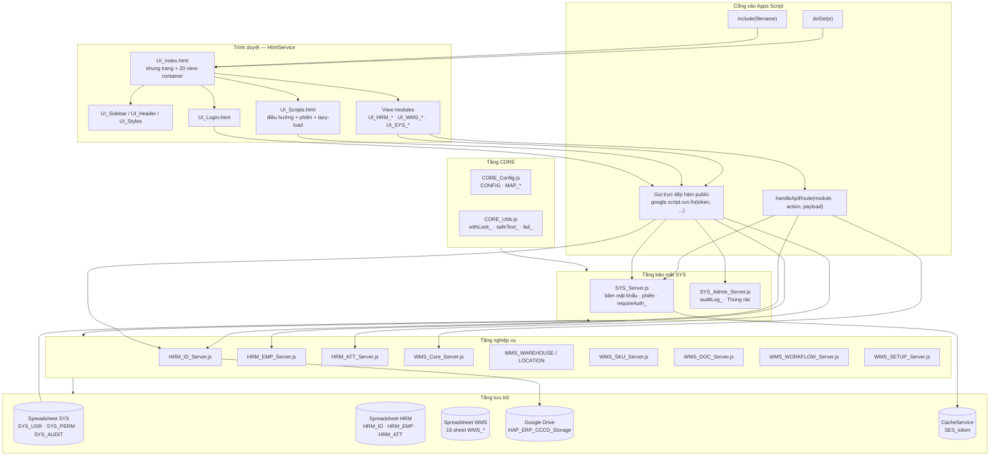
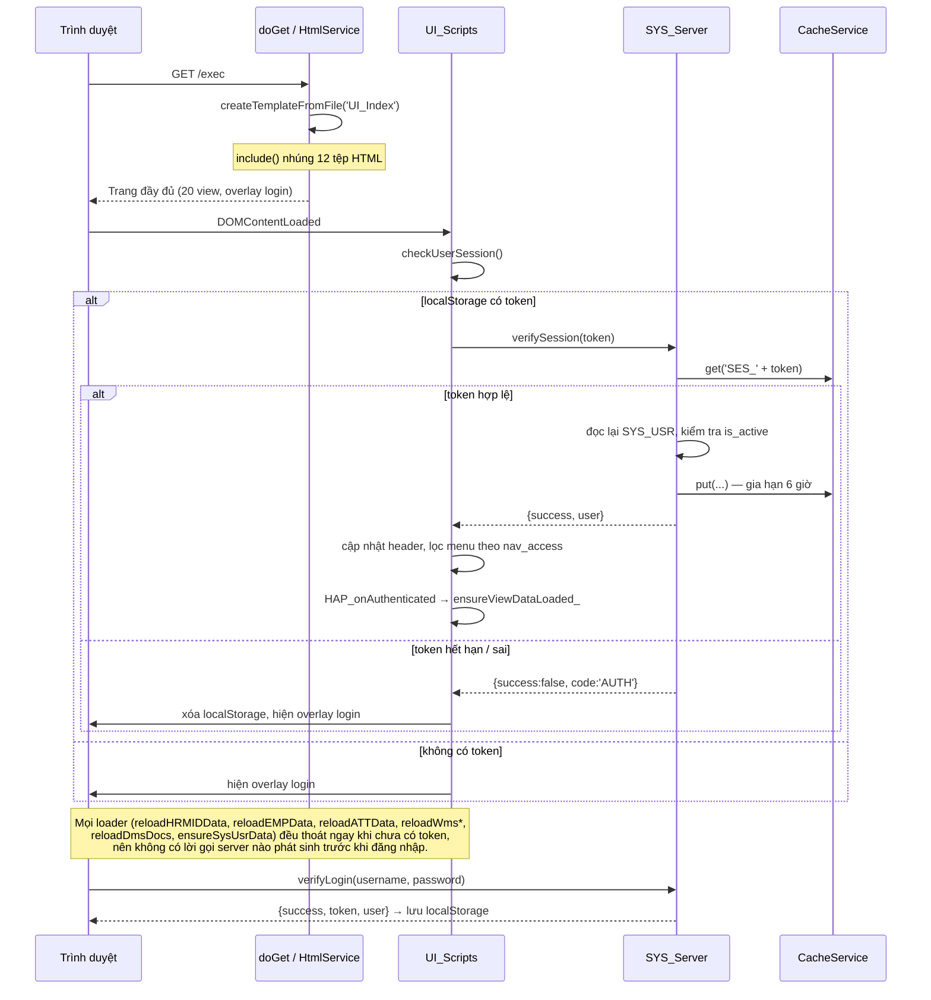
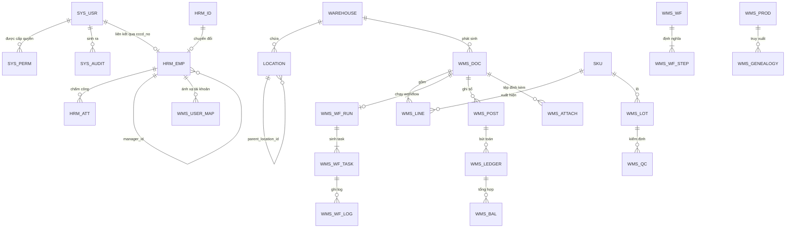
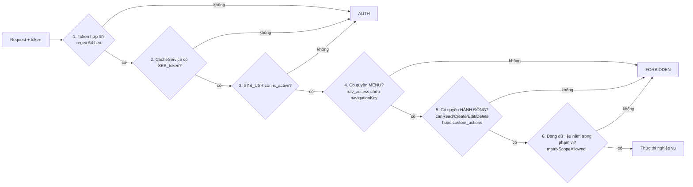
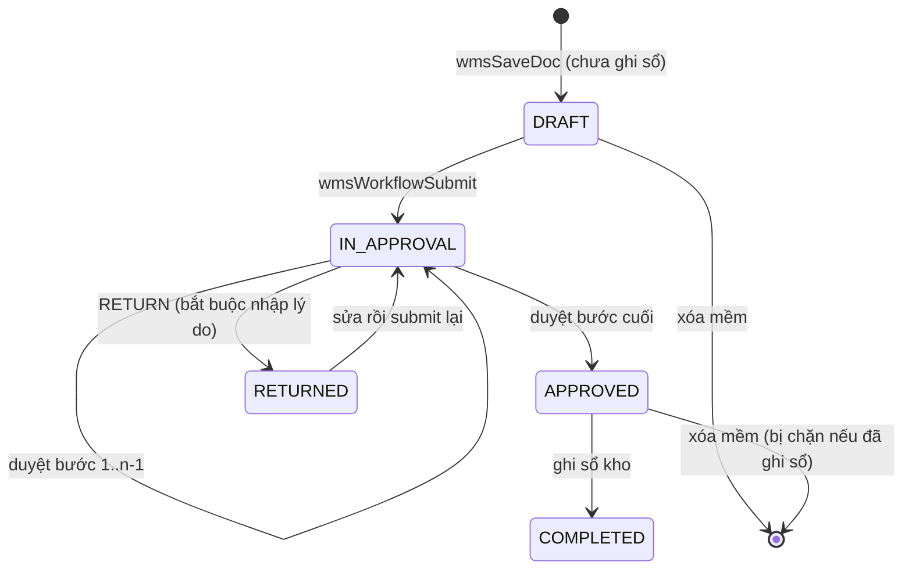
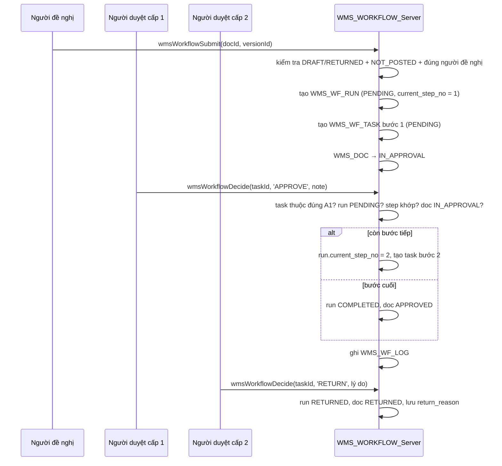
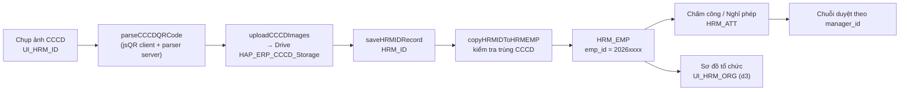
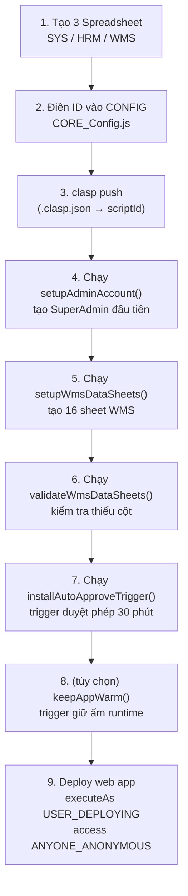
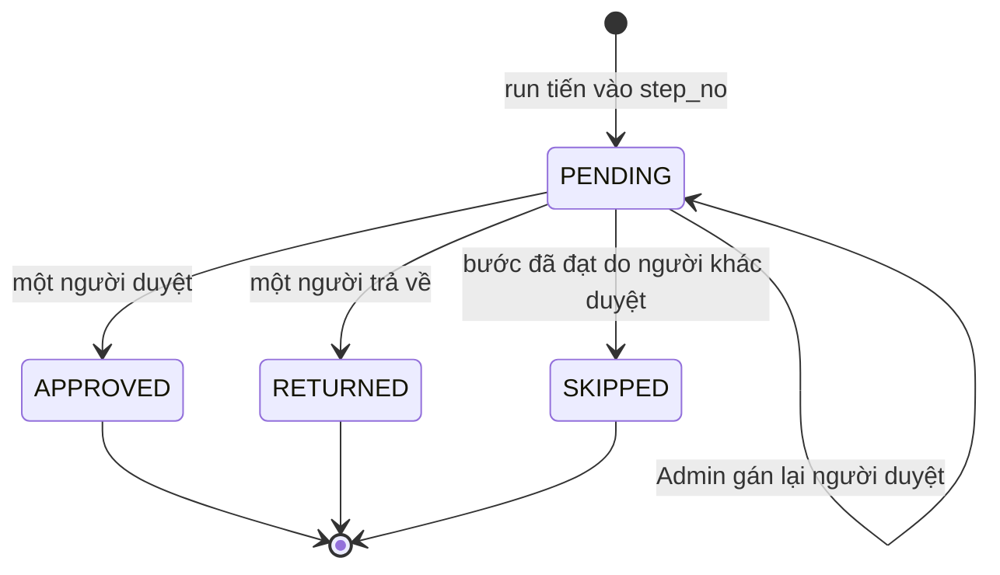
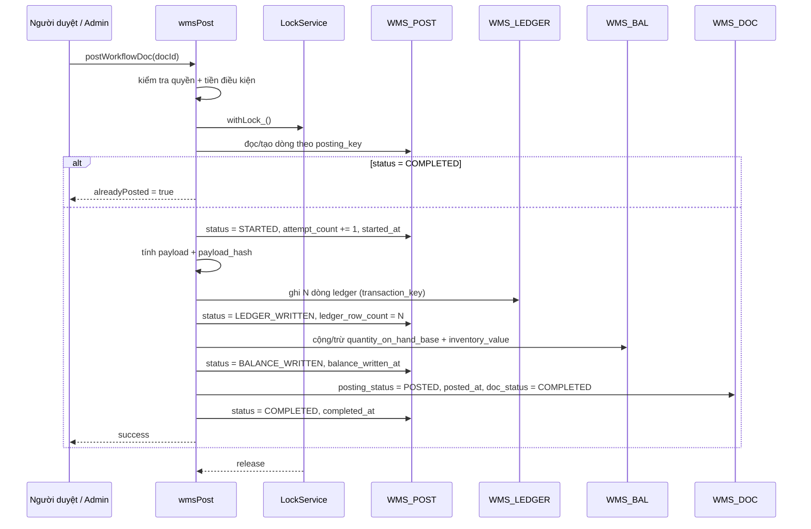

npx clasp push ; npx clasp deploy -i AKfycby118st5r2LkIzQMrta70cycs7DH6BQd7QCmj7obXcbFvABy9MIai4ooGNucpu_Qi84XA -d "v$(Get-Date -Format 'yyyy.MM.dd-HHmm')"
# KIẾN TRÚC HỆ THỐNG — HAP HOLDING ERP

> Tài liệu kiến trúc tổng thể, được lập bằng cách đọc toàn bộ mã nguồn `.js` và `.html` trong thư mục dự án.
>
> - **Nền tảng:** Google Apps Script (runtime V8) + Google Sheets (database) + Google Drive (lưu ảnh) + CacheService (phiên đăng nhập)
> - **Quy mô mã nguồn:** 33 tệp — 16 tệp `.js` (~11.900 dòng) + 16 tệp `.html` (~12.200 dòng) + 2 tệp cấu hình ≈ **24.100 dòng**
> - **Ngôn ngữ hiển thị:** Tiếng Việt · **Múi giờ:** `Asia/Ho_Chi_Minh`

---

## Mục lục

1. [Tổng quan hệ thống](#1-tổng-quan-hệ-thống)
2. [Kiến trúc phân tầng](#2-kiến-trúc-phân-tầng)
3. [Danh mục tệp và trách nhiệm](#3-danh-mục-tệp-và-trách-nhiệm)
4. [Luồng khởi động và xác thực](#4-luồng-khởi-động-và-xác-thực)
5. [Mô hình dữ liệu](#5-mô-hình-dữ-liệu)
6. [Cơ chế phân quyền (RBAC + ABAC)](#6-cơ-chế-phân-quyền-rbac--abac)
7. [Kiến trúc phân hệ WMS](#7-kiến-trúc-phân-hệ-wms)
8. [Kiến trúc phân hệ HRM](#8-kiến-trúc-phân-hệ-hrm)
9. [Quy ước lập trình](#9-quy-ước-lập-trình)
10. [Giao tiếp Client – Server](#10-giao-tiếp-client--server)
11. [Cấu hình và triển khai](#11-cấu-hình-và-triển-khai)
12. [Điểm mạnh, rủi ro và khuyến nghị](#12-điểm-mạnh-rủi-ro-và-khuyến-nghị)
13. [Phụ lục: Ánh xạ UI ↔ Server](#13-phụ-lục-ánh-xạ-ui--server)
14. [Đặc tả kỹ thuật: Nâng cấp phân hệ Cấu hình luồng duyệt (WMS)](#14-đặc-tả-kỹ-thuật-nâng-cấp-phân-hệ-cấu-hình-luồng-duyệt-wms)

---

## 1. Tổng quan hệ thống

**HAP HOLDING ERP** là ứng dụng web doanh nghiệp chạy hoàn toàn trên hạ tầng Google, không có server riêng:

| Thành phần hạ tầng | Vai trò |
|---|---|
| Google Apps Script | Runtime thực thi backend + phục vụ giao diện web app |
| Google Sheets | Cơ sở dữ liệu quan hệ "mô phỏng" (mỗi sheet = một bảng, hàng 1 = header) |
| Google Drive | Lưu ảnh CCCD, tài liệu đính kèm |
| CacheService (ScriptCache) | Lưu phiên đăng nhập (token), bộ đếm đăng nhập sai |
| LockService (ScriptLock) | Khóa toàn cục chống ghi chồng dữ liệu |
| PropertiesService | Lưu catalog hành động phân quyền tự sinh |

**Phân hệ nghiệp vụ hiện có:**

| Mã | Tên | Trạng thái |
|---|---|---|
| `HRM` | Nhân sự: tiếp nhận CCCD, hồ sơ nhân viên, sơ đồ tổ chức, chấm công & nghỉ phép | ✅ Hoạt động đầy đủ |
| `WMS` | Kho: danh mục kho/vị trí/SKU, phiếu nhập–xuất, luồng duyệt nhiều cấp | ✅ Hoạt động (xem mục 7.4 về ghi sổ kho) |
| `SYS` / `UAM` | Quản trị hệ thống: tài khoản, ma trận phân quyền, thùng rác, nhật ký | ✅ Hoạt động đầy đủ |
| `RMS` | Đề xuất / phê duyệt đề xuất | 🚧 Chỉ có khung giao diện |
| `MES` | Lệnh sản xuất, định mức BOM | 🚧 Chỉ có khung giao diện |
| `FMS` | Nhật ký canh tác trang trại | 🚧 Chỉ có khung giao diện |
| `DMS` | Kho tài liệu Drive | 🚧 Chỉ có khung giao diện |

---

## 2. Kiến trúc phân tầng

### 2.1. Sơ đồ tổng thể



### 2.2. Nguyên tắc phân tầng

| Tầng | Tệp | Trách nhiệm | Phụ thuộc |
|---|---|---|---|
| **CORE** | `CORE_Config.js`, `CORE_Utils.js`, `CORE_Router.js` | Cấu hình, tiện ích, cổng vào | Không phụ thuộc tầng nào |
| **SYS** | `SYS_Server.js`, `SYS_Admin_Server.js` | Xác thực, phân quyền, ghi nhật ký, thùng rác | CORE |
| **HRM** | `HRM_ID_Server.js`, `HRM_EMP_Server.js`, `HRM_ATT_Server.js` | Nghiệp vụ nhân sự | CORE + SYS |
| **WMS** | 9 tệp `WMS_*_Server.js` | Nghiệp vụ kho + workflow | CORE + SYS |
| **UI** | 16 tệp `UI_*.html` | Giao diện, gọi server | Gọi mọi hàm public |

> **Đặc thù Apps Script:** tất cả tệp chia sẻ **một không gian tên toàn cục duy nhất**. Vì vậy tầng được biểu diễn bằng **quy ước đặt tên** chứ không phải module/import:
> - Tiền tố `CORE_`, `SYS_`, `HRM_`, `WMS_` = tầng.
> - Hậu tố `_` (ví dụ `wmsCanRead_`, `getEffectivePermission_`) = **hàm nội bộ**, không thể gọi từ trình duyệt qua `google.script.run`. Đây là cơ chế "private" của hệ thống.

---

## 3. Danh mục tệp và trách nhiệm

### 3.1. Tệp cấu hình

| Tệp | Dòng | Nội dung |
|---|---|---|
| `.clasp.json` | 16 | `scriptId`, `rootDir: ""` (phẳng), hỗ trợ `.js/.gs`, `.html`, `.json` |
| `appsscript.json` | 9 | `timeZone: Asia/Ho_Chi_Minh`, `runtimeVersion: V8`, `executeAs: USER_DEPLOYING`, `access: ANYONE_ANONYMOUS` |

### 3.2. Backend `.js`

| Tệp | Dòng | Trách nhiệm chính | Hàm public tiêu biểu |
|---|---:|---|---|
| `CORE_Config.js` | 82 | Hằng số `CONFIG` (ID 3 spreadsheet, 26 tên sheet, `EMP_ID_PREFIX`, `MAX_ROWS_PER_SHEET = 30000`), `MAP_HRM_ID`, `MAP_SYS_USR` | — (chỉ dữ liệu) |
| `CORE_Router.js` | 221 | `doGet`, `include`, `handleApiRoute`, `routeSysModule`, `routeHrmModule`, `routeWmsModule` | `doGet`, `handleApiRoute` |
| `CORE_Utils.js` | 138 | `withLock_`, `cleanId_`, `safeText_`, `fmtDate_`, `fail_`, `diffFields_`, `deleteRowsByIndexes_`, `groupRuns_` | — (toàn bộ nội bộ) |
| `SYS_Server.js` | 2.871 | Băm mật khẩu, phiên, `requireAuth_`, ma trận phân quyền, CRUD tài khoản, schema hệ thống | `verifyLogin`, `verifySession`, `logoutSession`, `fetchSysUsersPaginated`, `getUserPermissionsDetailApi`, `saveUserFullPermissionsApi`, `savePermissionRuleApi`, `saveUserNavigationAccessApi`, `getSystemSchemaApi`, `setupAdminAccount`, `migratePasswords` |
| `SYS_Admin_Server.js` | 252 | `auditLog_`, `fetchAuditLog`, `fetchTrashList`, `restoreFromTrash`, `purgeFromTrash` | 4 hàm |
| `HRM_ID_Server.js` | 558 | Tiếp nhận CCCD: danh sách, parse QR, upload ảnh Drive, lưu, xóa mềm, chuyển sang HRM_EMP | 11 hàm |
| `HRM_EMP_Server.js` | 428 | Hồ sơ nhân viên 34 cột, import/export, cây quản lý `manager_id` | 7 hàm |
| `HRM_ATT_Server.js` | 1.288 | Chấm công, nghỉ phép theo lô, chuỗi duyệt tự động 24 giờ | 12 hàm |
| `WMS_Core_Server.js` | 293 | Enum trạng thái, `wmsGetSheet_`, `wmsRowsAsObjects_`, `wmsCanRead_`, `wmsSoftDelete_`, `wmsAudit_`, khóa ghi sổ idempotent | `keepAppWarm` |
| `WMS_POST_Server.js` | 589 | Ghi sổ kho (`wmsPost`, posting key/idempotent) | `wmsPost` |
| `WMS_WAREHOUSE_Server.js` | 232 | Danh mục kho | 3 hàm |
| `WMS_LOCATION_Server.js` | 252 | Danh mục vị trí, sắp xếp dạng cây theo mã | 3 hàm |
| `WMS_SKU_Server.js` | 545 | Danh mục hàng hóa, 16 nhóm, sinh mã ngắn tự tăng, import/export | 6 hàm |
| `WMS_DOC_Server.js` | 828 | Phiếu nhập/xuất + dòng chi tiết, cấp số phiếu, CRUD nháp | 5 hàm |
| `WMS_WORKFLOW_Server.js` | 1.287 | Định nghĩa workflow có phiên bản, bước duyệt, run/task/log, máy trạng thái duyệt | 9 hàm |
| `WMS_SETUP_Server.js` | 293 | Khai báo schema 16 sheet WMS, `setupWmsDataSheets`, `validateWmsDataSheets` | 2 hàm |

### 3.3. Giao diện `.html`

| Tệp | Dòng | Vai trò |
|---|---:|---|
| `UI_Index.html` | 143 | Khung trang; `include()` 12 tệp con; định nghĩa 20 `view-container` |
| `UI_Styles.html` | 216 | CSS toàn cục |
| `UI_Login.html` | 67 | Overlay đăng nhập → `verifyLogin` → lưu `localStorage['HAP_USER_SESSION']` |
| `UI_Scripts.html` | 317 | Điều hướng `switchView`, lọc menu theo quyền, `checkUserSession`, `HAP_TOKEN()`, `HAP_IS_AUTHED()`, `HAP_handleAuthFailure_()`, lazy-load |
| `UI_Sidebar.html` | 156 | Cây menu 7 phân hệ; các mục `.super-only` chỉ SuperAdmin thấy |
| `UI_Header.html` | 37 | Tên/avatar/vai trò người dùng |
| `UI_Dashboard.html` | 419 | Trang tổng quan |
| `UI_HRM_ID.html` | 1.404 | Bảng CCCD, quét QR bằng `jsQR`, xuất Excel bằng `XLSX` |
| `UI_HRM_EMP.html` | 981 | Bảng hồ sơ nhân viên, form chi tiết |
| `UI_HRM_ORG.html` | 525 | Sơ đồ tổ chức bằng `d3-org-chart` |
| `UI_HRM_ATT.html` | 1.910 | Chấm công dạng pivot, đơn nghỉ phép theo lô, duyệt |
| `UI_WMS_WAREHOUSE.html` | 573 | Tab Kho / Vị trí |
| `UI_WMS_SKU.html` | 1.367 | Danh mục SKU + import Excel |
| `UI_WMS_DOCS.html` | 923 | Phiếu nhập (`view-wms-in`) & xuất (`view-wms-out`) |
| `UI_WMS_WORKFLOW.html` | 595 | Cấu hình luồng duyệt + hộp thư duyệt |
| `UI_SYS_USR.html` | 2.846 | Master–detail tài khoản + ma trận phân quyền (điều kiện dùng dropdown `position: fixed`) + quyền menu |
| `UI_SYS_ADMIN.html` | 240 | Tab Thùng rác & Nhật ký thao tác |

> **Thư viện ngoài (CDN):** `xlsx@0.18.5` (import/export Excel), `jsqr@1.4.0` (quét QR CCCD), `d3-org-chart@3.0.1` + `d3-flextree@2.1.2` (sơ đồ tổ chức).

---

## 4. Luồng khởi động và xác thực

### 4.1. Trình tự khởi động



### 4.2. Cơ chế mật khẩu

- Định dạng lưu: `v1$<số_vòng>$<salt>$<hash>`
- Hash: SHA-256 lặp **500 vòng** (`AUTH_.HASH_ITER`), salt ngẫu nhiên mỗi người dùng.
- So sánh bằng `safeEquals_` (so sánh hằng thời gian, chống timing attack).
- Khi không tìm thấy user, vẫn chạy `hashPassword_` với salt giả để **thời gian phản hồi tương đương** → chống dò tài khoản.
- Chống dò mật khẩu: sai **5 lần** → khóa **15 phút** (bộ đếm `FAIL_<username>` trong CacheService), ghi audit `LOCKOUT`.
- `migratePasswords()` hỗ trợ nâng cấp hash cũ (không có tiền tố `v1$`) sang định dạng mới.

### 4.3. Phiên đăng nhập

| Thuộc tính | Giá trị |
|---|---|
| Token | Chuỗi 64 ký tự hex (2 UUID bỏ dấu `-`), kiểm tra bằng regex `^[a-f0-9]{64}$` |
| Lưu trữ | `CacheService.getScriptCache().put('SES_' + token, JSON, 21600)` |
| TTL | 6 giờ (`AUTH_.SESSION_TTL_SEC`), **tự gia hạn mỗi lần gọi** (sliding session) |
| Nội dung phiên | `username`, `fullName`, `role`, `modules`, `navAccess`, `cccd`, `loginAt` |
| Xác thực lại | Mỗi request đọc lại dòng `SYS_USR` để cập nhật `role/modules/navAccess/cccd` và kiểm tra `is_active` |
| Phía client | `localStorage['HAP_USER_SESSION'] = {...user, token}` — chỉ dùng để hiển thị, server không tin |

> **Nguyên tắc:** client **không bao giờ** gửi `username` cho các thao tác "của chính mình". Server lấy `cccd` từ phiên rồi tra `HRM_EMP` (xem `getEmployeeProfileByUsername`), tránh giả mạo danh tính.

### 4.4. Quy ước chống toast AUTH trước khi đăng nhập

Toàn bộ fragment HTML được `include()` vào cùng một tài liệu, nên mọi `<script>` chạy ngay khi tải trang — **trước** khi người dùng đăng nhập. Vì overlay login có `z-index: 9999` còn toast có `z-index: 999999`, bất kỳ toast nào phát sinh sớm sẽ đè lên màn hình đăng nhập.

Ba quy ước bắt buộc cho mọi loader gọi server:

| Quy ước | Helper | Áp dụng |
|---|---|---|
| Không gọi server khi chưa có token | `HAP_IS_AUTHED()` | Đầu mỗi hàm `reload*` / `fetch*` |
| Không hiện toast lỗi phiên khi chưa đăng nhập | `HAP_shouldSuppressAuthToast_(message)` | Đầu mỗi hàm toast (`showToast`, `showSysToast`, `showATTToast`) |
| Trả về màn hình đăng nhập khi phiên hết hạn | `HAP_handleAuthFailure_(res)` | Trong nhánh `!res.success` của mỗi handler |

`HAP_handleAuthFailure_(res)` trả `true` khi `res.code === 'AUTH'` (không phân biệt hoa/thường) → caller `return` ngay, không toast.

### 4.5. Quy ước dropdown chọn nhiều giá trị trong hộp thoại cuộn

`.sys-matrix-modal` đặt `overflow: hidden`, nên mọi khối xổ xuống lồng bên trong sẽ bị cắt. Vì vậy ô "Giá trị" của điều kiện ma trận dùng **trigger + panel `position: fixed`**:

| Thành phần | Vai trò |
|---|---|
| `.sys-matrix-value-select` | Bao ngoài, giữ nguyên class `.sys-matrix-condition-value` để luồng đọc/ghi giá trị không đổi |
| `.sys-matrix-value-trigger` | Nút hiển thị tóm tắt (`Tất cả` / `Chưa chọn giá trị` / `N giá trị đã chọn`) |
| `.sys-matrix-value-panel` | `position: fixed`, `z-index: 10050`, `max-height` ≤ 260 px, tự cuộn |

Helper điều phối: `openSysMatrixValuePanel_`, `closeSysMatrixValuePanels_` (chỉ một panel mở tại một thời điểm), `positionSysMatrixValuePanel_` (kẹp trong viewport, lật lên trên khi thiếu chỗ), `bindSysMatrixValuePanelGlobals_` (đóng khi click ngoài, cuộn, đổi kích thước, `Esc`).

Vì panel nằm **trong** `valueBox`, `saveSysMatrixRule` vẫn đọc được `input[value="__ALL__"]` và danh sách `input[type="checkbox"]:checked` như cũ. Giá trị khôi phục khi mở lại quy tắc được giữ ở biến `pendingValues` và áp ngay trong handler thành công của `getDistinctColumnValues` (không dùng `setTimeout`).

**Ngữ nghĩa ô "Tất cả":** `__ALL__` chỉ là công tắc tiện dụng, **không bao giờ** được lưu vào `SYS_PERM`.

| Hành vi | Cài đặt |
|---|---|
| Tích "Tất cả" | `applySysMatrixSelectAll_` tích **mọi giá trị thật** của cột (không lưu chuỗi `__ALL__`) |
| Tích đủ mọi giá trị bằng tay | `syncSysMatrixAllState_` tự tích lại "Tất cả" |
| Tích một phần | "Tất cả" ở trạng thái `indeterminate` |
| Bỏ tích "Tất cả" | Bỏ tích toàn bộ giá trị thật |
| Giá trị lưu xuống | CSV các giá trị thật đang tích (`WH01,WH02,WH03`); rỗng ⇒ điều kiện không hợp lệ và nút Lưu báo lỗi |

### 4.6. Quy ước bí danh tên sheet khi phân quyền

Một số module WMS kiểm tra quyền bằng **tên sheet ngắn** (`DOC`, `LINE`) trong khi giao diện ma trận lại lưu bằng **tên sheet dữ liệu thật** (`WMS_DOC`, `WMS_LINE`, do `getSystemSchemaApi` trả về). Hai helper trong `SYS_Server.js` làm cầu nối:

| Helper | Vai trò |
|---|---|
| `getPermissionSheetNames_(name)` | Trả về mọi cách viết tương đương của một tên sheet (hiện có `DOC ↔ WMS_DOC`, `LINE ↔ WMS_LINE`; tên khác dùng đúng nguyên văn) |
| `isPermissionBypassed_(name)` | Kiểm tra `CONFIG.BYPASS_PERMISSION_SHEETS` theo **mọi** bí danh, nên `LINE` và `WMS_LINE` cùng được bỏ qua |

Bắt buộc dùng hai helper này ở **mọi** chỗ so khớp `sheet_name` trong `SYS_PERM`: `getEffectivePermission_`, `matrixRowAllowed_`, `matrixScopeAllowed_`, `getKnownPermissionActions_`, `savePermissionRuleApi` (cả bước tìm dòng cũ để xóa lẫn bước xác nhận `savedCount`), `getPermissionRuleApi`. Nhờ vậy:

- Quyền đã lưu dưới dạng `DOC` vẫn có hiệu lực khi runtime hỏi `WMS_DOC` và ngược lại.
- Lần lưu lại đầu tiên sẽ **xóa dòng cũ** mang tên khác bí danh thay vì tạo dòng trùng.

> Thêm cặp bí danh mới chỉ cần sửa bảng `pairs` trong `getPermissionSheetNames_` — không phải sửa từng call site.

---

## 5. Mô hình dữ liệu

### 5.1. Ba spreadsheet

| Biến cấu hình | Nội dung | Sheets |
|---|---|---|
| `DB_SYS_PART1_ID` | Quản trị hệ thống | `SYS_USR`, `SYS_PERM`, `SYS_MOD`, `SYS_AUDIT` |
| `DB_HRM_PART1_ID` | Nhân sự | `HRM_ID`, `HRM_EMP`, `HRM_ATT` |
| `DB_WMS_PART1_ID` | Kho | 16 sheet (xem 5.3) |

`DB_SYS_PART2_ID` và `DB_HRM_PART2_ID` là **placeholder** (`"NHẬP_ID..."`) — chưa dùng, dự phòng khi dữ liệu vượt `MAX_ROWS_PER_SHEET = 30000`.

### 5.2. Quy ước chung

- **Hàng 1 = header**, dữ liệu từ hàng 2.
- Tra cột **theo tên header**, không theo vị trí: `headers.indexOf('doc_status')`. Nhờ vậy chèn/xóa cột không làm hỏng code.
- **Ngoại lệ hard-code:** cột cờ xóa mềm `HRM_ID` = cột 16 (`is_deleted`), `HRM_EMP` = cột 35.
- Mọi bảng đều có cột soft delete: `is_deleted | deleted_by | deleted_at` (HRM dùng `'Y'`, WMS dùng `TRUE/Y/1/YES`).
- Mọi bảng danh mục có audit cột: `created_by | created_at | updated_by | updated_at`.
- Cột mã (id/code/uom/status/username) được ép `setNumberFormat('@')` để Sheets không tự đổi `00123` → `123`.

### 5.3. Lược đồ các bảng chính



#### `SYS_USR` — Tài khoản (11 cột, thứ tự cố định trong `AUTH_.COL`)

| # | Cột | Ý nghĩa |
|---|---|---|
| 0 | `username` | Tên đăng nhập (khóa chính) |
| 1 | `password_hash` | `v1$500$salt$hash` |
| 2 | `cccd_no` | Số CCCD liên kết → dùng để xác định "nhân viên của chính mình" |
| 3 | `full_name` | Họ tên |
| 4 | `role` | `SuperAdmin` \| `ADMIN` \| `DIRECTOR` \| `DEPARTMENT_MANAGER` \| `EMPLOYEE` |
| 5 | `module_access` | CSV mã phân hệ hoặc `ALL` |
| 6 | `is_active` | `TRUE/FALSE` |
| 7 | `last_login` | Thời điểm |
| 8–9 | `created_by`, `created_at` | Audit |
| 10 | `nav_access` | CSV view-id được phép, hoặc `all` |

#### `SYS_PERM` — Ma trận phân quyền

| Cột | Ý nghĩa |
|---|---|
| `perm_id` | Khóa dòng |
| `target_type` | Hiện chỉ dùng `USER` |
| `target_value` | `username` |
| `sheet_name` | Bảng được phân quyền (`HRM_EMP`, `DOC`, `LINE`, `WMS_WF_TASK`…) |
| `scope_owner` | Chuỗi `MATRIX_RULE_V2:{...}` — xem 6.3 |
| `dept_filter`, `status_filter` | Dự phòng |
| `can_read`, `can_edit`, `can_delete` | Cờ quyền (can_create suy ra từ `can_edit` luồng nghiệp vụ) |
| `custom_actions` | CSV hành động mở rộng: `APPROVE`, `EXPORT`, `ATTENDANCE_PROXY`, `LEAVE_CREATE`… |

#### `SYS_AUDIT` — Nhật ký thao tác (tự tạo khi có bản ghi đầu tiên)

`time | username | module | action | record_key | detail`

#### `HRM_ID` — Tiếp nhận CCCD (15 cột + 3 cột xóa mềm, cờ ở cột 16)

`raw_qr | cccd_no | cmnd_no | full_name | gender | dob | perm_addr | merged_addr | curr_addr | issue_date | issue_place | img_front | img_back | created_by | created_at` + `is_deleted | deleted_by | deleted_at`

#### `HRM_EMP` — Hồ sơ nhân viên (34 cột, cờ xóa mềm ở cột 35)

`cccd_no | emp_id | full_name | dob | gender | curr_addr | avatar_url | phone | email | company_code | unit_code | dept_code | job_title | work_location | manager_id | join_date | contract_type | contract_no | contract_start_date | contract_end_date | contract_status | work_status | resign_date | salary_grade | base_salary | social_insurance_no | tax_code | bank_account_no | bank_name | bank_account_holder | academic_level | created_by | created_at | updated_at`

> `manager_id` tạo **cây tổ chức**: `getApprovalHierarchyForEmployee_(empId)` leo ngược `manager_id` (có chống vòng lặp bằng `visited`) → dùng cho chuỗi duyệt nghỉ phép.

#### `HRM_ATT` — Chấm công / nghỉ phép

`att_id | cccd_no | emp_id | full_name | dept_code | unit_code | work_date | work_month | work_shift | att_type | work_day_value | check_in | check_out | meal_qty | location_latlong | selfie_img | leave_reason | reject_reason | approval_status | created_by | created_at | unique_key` + `approval_chain | approval_step | approval_due_at | is_auto_approved | is_deleted | deleted_by | deleted_at`

- `unique_key = emp_id + "_" + yyyymmdd + "_" + work_shift` (chuẩn hóa lowercase, bỏ ký tự vô hình) → chống trùng.
- `approval_chain`: chuỗi `manager_id` nối bằng `>` tại **thời điểm nộp đơn** (snapshot, không đổi khi tổ chức thay đổi).

#### WMS — 16 sheet

| Sheet | Khóa chính | Mục đích |
|---|---|---|
| `WAREHOUSE` | `warehouse_id` | Kho: mã, tên, địa chỉ, mục đích, chế độ bảo quản, dải nhiệt độ |
| `LOCATION` | `location_id` | Vị trí trong kho, có `parent_location_id` (cây vị trí) |
| `SKU` | `sku_id` | Hàng hóa: 16 nhóm, `uom_base/uom_pack/pack_ratio`, `is_batch_managed`, `is_expiry_managed`, `qc_inspection_req`, min/max stock |
| `WMS_DOC` | `doc_id` | Header phiếu (31 cột) — trạng thái duyệt/ghi sổ/phiếu |
| `WMS_LINE` | `line_id` | Dòng phiếu (35 cột) — quy đổi đơn vị, lô, vị trí, giá vốn |
| `WMS_POST` | `posting_id` | Bản ghi ghi sổ, **idempotent qua `posting_key`** |
| `WMS_LEDGER` | `ledger_id` | Bút toán kho, **idempotent qua `transaction_key`** |
| `WMS_BAL` | `balance_id` | Tồn kho tổng hợp theo sku/kho/vị trí/lô/trạng thái |
| `WMS_LOT` | `lot_id` | Lô: hạn dùng, nhà cung cấp, trạng thái chất lượng |
| `WMS_QC` | `qc_event_id` | Sự kiện kiểm định chất lượng |
| `WMS_WF` | `workflow_version_id` | Phiên bản workflow (bất biến sau khi kích hoạt) |
| `WMS_WF_STEP` | `workflow_step_id` | Bước duyệt. **Một bước có $n$ người duyệt = $n$ dòng cùng `(workflow_version_id, step_no)`**; cột `approval_mode` = `SINGLE` \| `PARALLEL_ANY`; `is_stock_posting_step` đánh dấu bước ghi sổ (xem §14.2) |
| `WMS_WF_RUN` | `workflow_run_id` | Lần chạy cho một phiếu |
| `WMS_WF_TASK` | `task_id` | Task giao cho người duyệt |
| `WMS_WF_LOG` | `action_id` | Nhật ký quyết định duyệt |
| `WMS_PROD` | `production_batch_id` | Lệnh sản xuất |
| `WMS_GENEALOGY` | `genealogy_id` | Truy xuất nguồn gốc input→output |
| `WMS_ATTACH` | `attachment_id` | Tệp đính kèm trên Drive |
| `WMS_USER_MAP` | `mapping_id` | Cầu nối `username` ↔ `emp_id` (cần cho người duyệt) |

---

## 6. Cơ chế phân quyền (RBAC + ABAC)

### 6.1. Hai lớp kiểm soát



### 6.2. Vai trò

| Vai trò | Quyền đặc biệt |
|---|---|
| `SuperAdmin` | Toàn quyền mọi thứ; **duy nhất** được vào `view-sys-admin` (Thùng rác, Nhật ký); duy nhất quản lý tài khoản ADMIN/SuperAdmin |
| `ADMIN` | Quản lý tài khoản USER, cấu hình ma trận phân quyền và quyền menu; **không** thấy Thùng rác/Nhật ký |
| `DIRECTOR` | Theo ma trận phân quyền |
| `DEPARTMENT_MANAGER` | Theo ma trận phân quyền (thường là cấp duyệt 1) |
| `EMPLOYEE` | Theo ma trận phân quyền |

> `normalizeRoleCode_` chấp nhận cả tiếng Việt: `GIÁM ĐỐC` → `DIRECTOR`, `TRƯỞNG PHÒNG` → `DEPARTMENT_MANAGER`, `NHÂN VIÊN` → `EMPLOYEE`.

### 6.3. `MATRIX_RULE_V2` — phân quyền theo dòng dữ liệu

Lưu trong `SYS_PERM.scope_owner`:

```json
MATRIX_RULE_V2:{
  "conditions": [
    { "columnIndex": 11, "operator": "equals", "value": "P.KETOAN" }
  ],
  "canRead": true,
  "canCreate": false,
  "canEdit": true,
  "canDelete": false
}
```

| Thành phần | Giá trị hợp lệ |
|---|---|
| `columnIndex` | Chỉ số cột 0-based trong sheet |
| `operator` | `equals` \| `not_equals` \| `contains` \| `one_of` |
| `value` | Chuỗi so sánh (lowercase, trim) |
| Số điều kiện | 1–12, kết hợp **AND** |

Ngữ nghĩa:
- `conditions` rỗng ⇒ áp cho **mọi dòng**.
- Nhiều bản ghi `SYS_PERM` cho cùng user+sheet ⇒ **hợp (OR)** các rule: `effective.canRead = canRead || rule.canRead`.
- Không có bản ghi nào ⇒ **mặc định từ chối** (`canRead: false`).
- Thực thi: `matrixRowAllowed_` (đọc) và `matrixScopeAllowed_` (ghi/xóa).

### 6.4. Quyền truy cập menu (`nav_access`)

- `SYS_USR.nav_access` = CSV các **view-id** (ví dụ `view-hrm-emp,view-wms-in`) hoặc `all`.
- Khóa menu có thể gồm hậu tố khi **một view-id có nhiều mục menu** (ví dụ `view-sys-admin` xuất hiện ở cả Thùng rác và Nhật ký) → `navigationKeyFor_` sinh `view-sys-admin-nhat-ky-thao-tac`.
- **Client** (`applyNavigationPermissions_`) chỉ **ẩn/hiện** menu.
- **Server** (`userHasNavigationAccess_`) mới là nơi **quyết định**: mỗi hàm backend nhận `navigationKey` (có thể nhiều key cách nhau dấu phẩy, ví dụ `'view-hrm-emp,view-hrm-org,view-hrm-att'`) và kiểm tra lại.
- `view-sys-admin*` **luôn** chỉ SuperAdmin, kiểm tra ở cả hai phía.

### 6.5. Catalog hành động động

- Hành động chuẩn: `view`, `self`, `create`, `update`, `delete`, `purge`.
- Hành động mở rộng được **tự đăng ký** khi lần đầu gọi: `registerPermissionAction_` ghi vào `PropertiesService` khóa `SYS_PERMISSION_ACTION_CATALOG_V1` (JSON `{ "HRM_ATT": ["ATTENDANCE_SELF", ...] }`).
- Hành động dựng sẵn theo bảng: `getBuiltInPermissionActions_` (HRM_ATT, HRM_EMP, HRM_ID).
- Nhãn tiếng Việt: `getPermissionActionLabel_`.

---

## 7. Kiến trúc phân hệ WMS

### 7.1. Vòng đời phiếu



Trạng thái lưu ở 3 cột độc lập trong `WMS_DOC`:

| Cột | Enum | Giá trị |
|---|---|---|
| `doc_status` | `WMS_DOC_STATUS_` | `DRAFT, IN_APPROVAL, RETURNED, APPROVED, COMPLETED, CANCELLED` |
| `approval_status` | `WMS_APPROVAL_STATUS_` | `DRAFT, PENDING, RETURNED, APPROVED, CANCELLED` |
| `posting_status` | `WMS_POSTING_STATUS_` | `NOT_POSTED, POSTING, POSTED, POST_FAILED, REVERSED` |

### 7.2. Loại phiếu

`WMS_DOC_TYPES_` khai báo 7 loại, nhưng `WMS_DOC_TYPES_ALLOWED_` **chỉ mở 2 loại** trên giao diện:

| Loại | Trạng thái | View |
|---|---|---|
| `PURCHASE_RECEIPT` | ✅ | `view-wms-in` |
| `SALES_ISSUE` | ✅ | `view-wms-out` |
| `CUSTOMER_RETURN`, `PRODUCTION_ISSUE`, `PRODUCTION_RECEIPT`, `TRANSFER`, `STOCK_ADJUSTMENT` | 🚧 khai báo nhưng chưa có UI/luồng | — |

### 7.3. Máy trạng thái workflow



**Kiểm tra nghiệp vụ bắt buộc trước khi duyệt:**
1. Task phải thuộc đúng `approver_username` đang đăng nhập.
2. `task_status = PENDING` và `run.run_status = PENDING` và `run.current_step_no = task.step_no`.
3. `doc.workflow_run_id = run.id` và `doc.doc_status = IN_APPROVAL`.
4. `doc.posting_status = NOT_POSTED` và `is_deleted` khác true.
5. **Chống tự duyệt:** nếu người duyệt chính là người đề nghị và `step.can_self_approve` khác true ⇒ `FORBIDDEN`.
6. Toàn bộ nằm trong `withLock_`; nếu ghi lỗi giữa chừng thì **hoàn nguyên** các dòng đã ghi (rollback thủ công bằng `oldTask/oldRun/oldDoc`).

**Workflow có phiên bản (versioned):** `WMS_WF` + `WMS_WF_STEP` là bất biến sau khi `ACTIVE`; sửa = tạo phiên bản mới ⇒ phiếu đang chạy giữ nguyên chuỗi bước cũ. Còn bản `DRAFT` thì sửa **tại chỗ** — xem đặc tả §14.5.

Mô hình duyệt hiện tại là **tuần tự, đúng một người duyệt mỗi bước**. Đợt nâng cấp bổ sung **duyệt song song kiểu "một-đủ"** cấu hình theo bước — xem §14.3.

### 7.4. Ghi sổ kho (posting)

Thiết kế đã có đầy đủ **hợp đồng** nhưng **chưa có hàm thực thi**:

| Hạng mục | Trạng thái |
|---|---|
| Enum `WMS_POSTING_STATUS_`, `WMS_POSTING_PHASES_`, `WMS_LEDGER_TYPES_` | ✅ có |
| Sheet `WMS_POST`, `WMS_LEDGER`, `WMS_BAL` + schema | ✅ có |
| Hàm sinh khóa idempotent `wmsPostingKey_`, `wmsLedgerTransactionKey_` | ✅ có |
| Cột `is_stock_posting_step` trong `WMS_WF_STEP/TASK` | ✅ có (hiện **hard-code `false`** tại `WMS_WORKFLOW_Server.js:574` và `:1115`) |
| Hàm thực hiện ghi sổ (`wmsPost`) | ✅ có (`WMS_POST_Server.js`) |

**Thiết kế khóa idempotent (đã có sẵn, chỉ chờ hiện thực):**
```
posting_key     = WMS_POST_V1|<doc_id>|<run_id>|<step_id>|<posting_type>
transaction_key = <posting_key>|<line_id>|<leg>
```
Pha ghi sổ dự kiến: `STARTED → LEDGER_WRITTEN → BALANCE_WRITTEN → COMPLETED` (hoặc `FAILED`), cho phép **retry an toàn** theo `posting_key` mà không sinh bút toán trùng.

> ⚠️ **Kết luận:** hiện tại phiếu đi hết luồng duyệt sẽ dừng ở `doc_status = APPROVED` / `posting_status = NOT_POSTED`. Tồn kho (`WMS_BAL`) và sổ cái (`WMS_LEDGER`) **chưa được cập nhật** ⇒ màn hình `view-wms-inv` (Báo cáo tồn kho) cũng chỉ là khung.
>
> 📌 Hợp đồng chi tiết của `wmsPost` (tiền điều kiện, sinh bút toán, `simple_amount`, chống tồn âm, ghi sổ lại, đảo bút toán) được đặc tả tại **§14.4**.

### 7.5. Xóa mềm có kiểm soát phiên bản

`wmsSoftDelete_(auth, source, table, idField, idValue, expectedUpdatedAt, label, beforeDelete)`:
1. `withLock_` → tìm dòng theo id.
2. Nếu `is_deleted` đã bật ⇒ báo đã xóa.
3. Nếu `expectedUpdatedAt` khác `updated_at` hiện tại ⇒ `code: 'STALE_RECORD'` (optimistic concurrency).
4. `matrixScopeAllowed_(..., 'delete')`.
5. `beforeDelete` callback (ví dụ chặn xóa phiếu đã ghi sổ).
6. Ghi `is_deleted = true`, `updated_by`, `updated_at`; ghi audit `SOFT_DELETE`.

---

## 8. Kiến trúc phân hệ HRM

### 8.1. Chuỗi nghiệp vụ



### 8.2. Đặc thù HRM_ID

- Ảnh CCCD lưu trên Drive trong thư mục `HAP_ERP_CCCD_Storage` (hoặc `CONFIG.DRIVE_FOLDER_ID`), **chia sẻ hạn chế** (`secureExistingCCCDImageSharing` để gia cố quyền cho ảnh cũ).
- Server **không trả URL ảnh** trong danh sách; chỉ trả cờ `has_img_front/has_img_back`, ảnh tải riêng qua `getHRMIDImage` (kiểm tra quyền từng lần).
- `parseCCCDQRCode` đọc chuỗi QR chuẩn CCCD gắn chip, tách các trường phân tách bằng `|`.
- Chống trùng: `cccd_no` là khóa nghiệp vụ; `raw_qr` lưu nguyên bản để đối chiếu.

### 8.3. Đặc thù HRM_EMP

- 34 cột dữ liệu; `emp_id` sinh theo `EMP_ID_PREFIX = "2026"` + số thứ tự 4 chữ số (`20260001`).
- `empTextCols_()` ép các cột mã sang text để không mất số 0 đầu.
- `normalizeEmpTextColumns()` là hàm bảo trì chạy tay để chuẩn hóa định dạng cột.
- Xóa mềm, khôi phục qua Thùng rác (`SYS_Admin_Server`).

### 8.4. Đặc thù HRM_ATT — duyệt nghỉ phép tự động

| Khái niệm | Giá trị |
|---|---|
| Chuỗi duyệt | `getApprovalHierarchyForEmployee_(emp_id).hierarchy` — leo `manager_id` ngược lên |
| Không có quản lý | Đơn **tự động "Đã duyệt"** ngay khi nộp |
| `approval_step` | Bước hiện tại (1-based); `0` khi đã xong |
| `approval_due_at` | Hạn tự duyệt, chỉ đặt khi **cấp cuối** (= bước cuối của chuỗi) |
| `APPROVAL_AUTO_HOURS_` | `24` giờ |
| `autoApproveTick()` | Trigger 30 phút/lần (`installAutoApproveTrigger`) |
| `runLeaveAutoApprove_()` | Duyệt tự động đơn cấp cuối quá hạn, đặt `is_auto_approved = 'Y'`, ghi lý do vào `reject_reason` |
| Lazy sweep | Trong `fetchHRMATTListPaginated`, nếu quá 5 phút chưa quét (`LV_SWEEP`) thì chạy `runLeaveAutoApprove_()` — dự phòng khi chưa cài trigger |

**Chống tự duyệt đơn của mình:** `isCurrentApprover` yêu cầu `cleanCompareKey_(it.emp_id) !== myKeyV`.

**Quyền đặc thù (custom actions):** `ATTENDANCE_SELF`, `ATTENDANCE_PROXY` (chấm công thay), `LEAVE_CREATE`, `APPROVE`, `REJECT`.

---

## 9. Quy ước lập trình

### 9.1. Đặt tên

| Quy ước | Ý nghĩa | Ví dụ |
|---|---|---|
| `TIỀN_TỐ_` | Tầng sở hữu | `CORE_`, `SYS_`, `HRM_`, `WMS_`, `UI_` |
| `tenHam_` (gạch dưới cuối) | **Nội bộ** — trình duyệt không gọi được | `wmsCanRead_`, `fail_`, `withLock_` |
| `tenHam` (không gạch dưới) | **Public** — gọi được từ client | `fetchHRMEMPListPaginated`, `wmsSaveDoc` |
| `HANG_SO_` (IN HOA + `_`) | Hằng số | `WMS_DOC_STATUS_`, `AUTH_`, `APPROVAL_AUTO_HOURS_` |
| `map..._` / `build..._` | Hàm biến đổi dữ liệu | `mapIdRow_`, `buildApprovalPlan_` |
| `snapshot` trong tên cột | Giá trị **chụp lại** tại thời điểm giao dịch, không join lại | `sku_name_snapshot`, `approver_name_snapshot` |

### 9.2. Ghi dữ liệu an toàn

```javascript
// Mẫu chuẩn của mọi thao tác ghi
return withLock_(function () {
  // 1. đọc lại dữ liệu trong lock
  // 2. kiểm tra quyền + phạm vi dòng (matrixScopeAllowed_)
  // 3. kiểm tra nghiệp vụ (STALE_RECORD, trạng thái, ràng buộc)
  // 4. ghi đúng dòng, đúng số cột: sheet.getRange(row, 1, 1, headers.length).setValues([row])
  // 5. auditLog_ / wmsAudit_
  // 6. trả { success: true, message, ... }
});
```

- `withLock_` dùng `LockService.getScriptLock().tryLock(20000)`; hết thời gian chờ ⇒ trả thông báo thân thiện thay vì lỗi.
- Ghi theo **nguyên dòng** (`setValues([row])`) thay vì từng ô → giảm số lần gọi API.
- Đọc theo **cả cột** một lần (`getRange(2, col, n, 1).getValues()`) khi cần quét.

### 9.3. Phòng chống tấn công

| Rủi ro | Biện pháp | Nơi hiện thực |
|---|---|---|
| Chèn công thức (CSV/Excel injection) | `safeText_`: tiền tố `'` cho `= + - @` | `CORE_Utils.js:31` |
| HTML/XSS | `escapeHtml` ở mọi chỗ render chuỗi người dùng | từng `UI_*.html` |
| Dò mật khẩu | Rate-limit 5 lần/15 phút + dummy hash | `verifyLogin` |
| Timing attack | `safeEquals_` | `SYS_Server.js:69` |
| Gọi hàm nội bộ từ client | Hậu tố `_` (Apps Script chặn) | toàn hệ thống |
| Ghi đè dữ liệu người khác | `expectedUpdatedAt` → `STALE_RECORD` | `wmsSoftDelete_` |
| Leo thang đặc quyền | ADMIN không tạo/sửa được ADMIN/SuperAdmin; không tự đổi vai trò mình | `saveSysUser`, `updateSysUserStatus` |
| Chạy hàm setup từ xa | `isOwnerRun_()` (active user = effective user) | `setupAdminAccount`, `migratePasswords` |
| Mất số 0 đầu mã | `setNumberFormat('@')`, `empTextCols_` | HRM / WMS setup |

### 9.4. Envelope phản hồi chuẩn

```javascript
{ success: true,  message: "...", list: [...], totalRows: 0, permissions: {...} }
{ success: false, message: "...", code: "AUTH" | "FORBIDDEN" | "STALE_RECORD" | "CONFIG", list: [] }
```

### 9.5. Nguyên tắc hiệu năng dữ liệu (Apps Script + Google Sheets)

Áp dụng đồng nhất trên mọi tính năng giao diện và mọi phân hệ (WMS, HRM, SYS,...) để đảm bảo tốc độ load bảng và tính chính xác đồng bộ dữ liệu.

#### 9.5.1. Nguyên tắc cốt lõi

| # | Nguyên tắc | Mô tả |
|---|-----------|-------|
| P1 | **Đọc theo nhu cầu, không đọc toàn bộ sheet** | Tránh `getDataRange()` toàn bộ sheet cho bảng lớn. Dùng `getRange()` theo đoạn cần thiết, hoặc `Sheet.createTextFinder()` để chỉ quét cột khớp. |
| P2 | **Pagination server-side** | UI gửi `page`/`pageSize`; server chỉ trả về trang hiện tại và `total`. Không kéo toàn bộ dữ liệu về rồi cắt ở client. |
| P3 | **Cache dữ liệu tham chiếu ít thay đổi** | WAREHOUSE, LOCATION, SKU, WMS_WF, WMS_WF_STEP dùng `CacheService` (TTL 120s). Invalid cache ngay khi có `save`/`update`/`delete`. |
| P4 | **Batch read/write** | Dùng `getValues()`/`setValues()` cho block ô, không đọc/ghi cell-by-cell. |
| P5 | **LockService cho writes đồng thời** | Tất cả thao tác ghi (create/update/delete) phải bọc trong `withLock_()` để tránh ghi chồng. |
| P6 | **Đồng bộ cache khi dữ liệu thay đổi** | Mọi hàm `save`/`delete` phải gọi `invalidate...Cache_()` liên quan sau khi ghi thành công. |
| P7 | **SuperAdmin short-circuit** | SuperAdmin (`isSuperAdminRole_()`) trả về full permission ngay, không đọc sheet `SYS_PERM`. Áp dụng tại `getEffectivePermission_`, `hasPermission_`, `userHasNavigationAccess_`, `userHasModuleAccess_`. |
| P8 | **Tính chính xác trước tốc độ** | Không bỏ qua kiểm tra quyền hoặc kiểm tra trùng lặp chỉ để nhanh. Tối ưu cách đọc, không bỏ kiểm tra. |

#### 9.5.2. Mẫu chuẩn cho hàm liệt kê danh sách (pagination)

```javascript
function wmsListXxx(token, searchKey, page, pageSize) {
  // 1. Xác thực phân quyền (short-circuit SuperAdmin nếu có)
  var auth = ...;
  if (!auth.ok) return auth.result;

  // 2. Đọc dữ liệu (từ cache nếu là bảng tham chiếu, hoặc getRange theo đoạn)
  var source = wmsGetSheet_('SHEET_XXX', HEADER_XXX);
  var rows = ...; // đọc toàn bộ hoặc theo trang tùy kích thước

  // 3. Filter quyền (matrixRowAllowed_), filter từ khóa, tính total
  var visible = rows.filter(...);
  var total = visible.length;

  // 4. Pagination server-side
  page = Math.max(1, parseInt(page, 10) || 1);
  pageSize = Math.min(100, Math.max(1, parseInt(pageSize, 10) || 30));
  var pages = Math.max(1, Math.ceil(total / pageSize));
  page = Math.min(page, pages);
  var pageRows = visible.slice((page - 1) * pageSize, page * pageSize);

  // 5. Chỉ load chi tiết liên quan (ví dụ WMS_LINE chỉ của doc_id trong trang)
  // ...

  return {
    success: true,
    list: pageRows,
    total: total,
    page: page,
    page_size: pageSize,
    page_count: pages
  };
}
```

#### 9.5.3. Mẫu chuẩn cho hàm cache bảng tham chiếu

```javascript
var XXX_CACHE_TTL_SEC = 120;
var _xxxCache_ = null;
var _xxxCacheTime_ = 0;

function getXxxCache_() {
  var now = Date.now();
  if (_xxxCache_ && now - _xxxCacheTime_ < XXX_CACHE_TTL_SEC * 1000) return _xxxCache_;
  var cache = CacheService.getScriptCache();
  var raw = cache.get('WMS_XXX_CACHE');
  if (raw) { try { _xxxCache_ = JSON.parse(raw); _xxxCacheTime_ = now; return _xxxCache_; } catch (e) { cache.remove('WMS_XXX_CACHE'); } }
  return null;
}

function setXxxCache_(list) {
  _xxxCache_ = list; _xxxCacheTime_ = Date.now();
  try { CacheService.getScriptCache().put('WMS_XXX_CACHE', JSON.stringify(list), XXX_CACHE_TTL_SEC); } catch (e) {}
}

function invalidateXxxCache_() {
  _xxxCache_ = null; _xxxCacheTime_ = 0;
  try { CacheService.getScriptCache().remove('WMS_XXX_CACHE'); } catch (e) {}
}
```

- Gọi `setXxxCache_()` sau khi đọc sheet lần đầu (cache miss).
- Gọi `invalidateXxxCache_()` sau mọi `save`/`update`/`delete` thành công.

#### 9.5.4. Mẫu chuẩn để đọc theo cột (không đọc toàn bộ sheet)

```javascript
function wmsReadByColumnFast_(source, columnName, expectedValue) {
  var colIndex = source.headers.indexOf(columnName);
  var lastRow = source.sheet.getLastRow();
  if (lastRow < 2) return [];
  var ranges = source.sheet.createTextFinder(String(expectedValue || ''))
    .matchEntireCell(true).matchCase(false)
    .startRow(2).startColumn(colIndex + 1).numRows(lastRow - 1).numColumns(1)
    .findAll();
  if (!ranges.length) return [];
  var minRow = ranges[0].getRowIndex();
  var maxRow = ranges[ranges.length - 1].getRowIndex();
  var allRows = source.sheet.getRange(minRow, 1, maxRow - minRow + 1, source.headers.length).getValues();
  var rangeSet = {};
  ranges.forEach(function(range) { rangeSet[range.getRowIndex()] = true; });
  var results = [];
  allRows.forEach(function(row, offset) {
    var actualRow = minRow + offset;
    if (rangeSet[actualRow]) results.push({ index: actualRow - 2, row: row });
  });
  return results;
}
```

Áp dụng khi cần tìm 1–N dòng theo mã/id trong sheet lớn (ví dụ WMS_LINE theo `doc_id`, WMS_WF_RUN theo `workflow_run_id`, WMS_WF_TASK theo `task_id`).

#### 9.5.5. Áp dụng đã thực hiện (ghi chép lịch sử)

| Giai đoạn | Bảng | Cách tiếp cận | File |
|-----------|------|--------------|------|
| 1 | WAREHOUSE | Cache 2 cấp (memory + CacheService), invalidate khi save/delete | `WMS_WAREHOUSE_Server.js` |
| 2 | LOCATION | Cache 2 cấp, invalidate khi save/delete | `WMS_LOCATION_Server.js` |
| 3 | SKU | Cache 2 cấp, invalidate khi save/delete/batch delete | `WMS_SKU_Server.js` |
| 4 | WMS_DOC | Pagination server-side, chỉ đọc WMS_LINE của doc trong trang | `WMS_DOC_Server.js` |
| 5 | WMS_LINE | `TextFinder` đọc theo `doc_id` thay vì toàn bộ sheet | `WMS_DOC_Server.js` |
| 6 | WMS_WF, WMS_WF_STEP | Cache 2 cấp, invalidate khi save/activate/lock/delete | `WMS_WORKFLOW_Server.js` |
| 7 | WMS_WF_RUN, WMS_WF_TASK, WMS_WF_LOG | `TextFinder` đọc theo id thay vì toàn bộ sheet | `WMS_WORKFLOW_Server.js` |
| 8 | SuperAdmin short-circuit | Trả về full permission không đọc `SYS_PERM` | `SYS_Server.js` |
| 9 | SYS_PERM_CONDITIONS | Đọc toàn bộ sheet **1 lần/request**, tra theo `perm_id` trong bộ nhớ (trước: 1 lần **mỗi rule**) | `SYS_Server.js` |
| 10 | SYS_PERM | `getEffectivePermission_` ghi nhớ theo `user + role + bảng` trong phạmvi request; tra cứu sheet ghi nhớ `_sheetLookupCache_` (không mở lại Spreadsheet cho mỗi điều kiện của mỗi rule) | `SYS_Server.js` |
| 11 | SYS_USR | `invalidateAllPermissionCache_()` sau khi tạo/sửa/khoá tài khoản và sau khi sửa quyền menu — cache `PERM_` được tính theo vai trò nên phải xoá khi đổi vai trò | `SYS_Server.js` |
| 12 | SYS_PERM | `withLock_()` cho `savePermissionRuleApi`, `deletePermissionRulesApi`, `saveUserFullPermissionsApi` (đọc–ghi–ghi cùng 1 sheet) | `SYS_Server.js` |

#### 9.5.6. Bộ nhớ tạm theo request (request-scoped memo)

Hạ tầng bổ sung từ giai đoạn 9 ở bảng §9.5.5.

| Hàm | Tệp | Công dụng |
|---|---|---|
| `requestMemo_(key, producer)` | `CORE_Utils.js` | Tính giá trị **1 lần** rồi ghi nhớ trong phạm vi 1 request; tự xoá sau 60s không dùng |
| `clearRequestMemo_()` | `CORE_Utils.js` | Xoá bộ nhớ tạm |

Quy tắc sử dụng:

- `requireSessionAuth_()` gọi `clearRequestMemo_()` → mỗi lần gọi API là một request sạch, không dùng lại dữ liệu của request trước.
- `handleApiRoute()` cũng gọi `clearRequestMemo_()` để chặn đường gọi qua router.
- Bộ nhớ tạm **không thay thế** `CacheService` (cache dùng chung nhiều request) và **không thay thế** kiểm tra quyền.
- `getEffectivePermission_()` giữ nguyên short-circuit SuperAdmin (P7) **trước** khi tra bộ nhớ.
- Hàm trả về từ bộ nhớ phải trả **bản sao** nếu người gọi có thể sửa (vd. `getPermConditions_` trả bản sao để `resolveRuleColumns_` không làm hỏng bộ nhớ dùng chung).
- Sau mọi thao tác ghi phân quyền phải gọi `invalidatePermissionCache_()` / `invalidateAllPermissionCache_()` (P6) — hai hàm này cũng gọi `clearRequestMemo_()`.

---

## 10. Giao tiếp Client – Server

### 10.1. Hai phong cách gọi song song

| Phong cách | Cách dùng | Nơi áp dụng |
|---|---|---|
| **Trực tiếp** | `google.script.run.withSuccessHandler(...).fetchHRMEMPListPaginated(token, 1, 50)` | Toàn bộ HRM, `SYS_Admin_Server`, `verifyLogin/verifySession/logoutSession` |
| **Qua router** | `google.script.run...handleApiRoute('WMS', 'saveDoc', {token, ...})` | Toàn bộ WMS, phần lớn SYS_USR |

### 10.2. Danh sách action của router

**`routeSysModule`** — 12 action:
`verifyLogin`, `getSysUsersList`, `saveSysUser`, `updateSysUserStatus`, `getSysUserLoginHistory`, `getSystemSchema`, `savePermissionRule`, `getPermissionRule`, `saveUserNavigationAccess`, `fetchSysUsersPaginated`, `getUserPermissionsDetail`, `saveUserFullPermissions`

**`routeHrmModule`** — 2 action:
`fetchHRMEMPListPaginated`, `fetchHrmIdList`

**`routeWmsModule`** — 28 action:
`listWarehouses`, `saveWarehouse`, `deleteWarehouse`, `listLocations`, `saveLocation`, `deleteLocation`, `listSkus`, `suggestSkuCode`, `saveSku`, `importSkus`, `deleteSku`, `deleteSkus`, `listDocOptions`, `listDocs`, `getDoc`, `saveDoc`, `deleteDocs`, `getWorkflowSetup`, `saveWorkflow`, `activateWorkflow`, `setWorkflowStatus`, `saveWorkflowMapping`, `setWorkflowMappingStatus`, `listMyWorkflowTasks`, `submitWorkflow`, `decideWorkflowTask`, `reassignWorkflowTask`*, `postWorkflowDoc`*

\* Hai action cuối **chưa hiện thực** — sẽ thêm theo đặc tả §14.9.

Mỗi nhánh đều có guard `typeof fn === 'function'` và trả `{success:false, message:'Hàm X chưa khai báo'}` nếu tệp backend bị thiếu — cơ chế **fail-safe** khi deploy thiếu tệp.

### 10.3. Nạp dữ liệu lười (lazy load)

`UI_Scripts.ensureViewDataLoaded_(viewId)` chỉ tải dữ liệu **lần đầu** mở view, đánh dấu trong `HAP_VIEW_DATA_LOADED`:

| View | Loader |
|---|---|
| `view-hrm-id` | `reloadHRMIDData` |
| `view-hrm-emp` | `reloadEMPData` |
| `view-hrm-att` | `reloadATTData` |
| `view-wms-warehouse` | `reloadWmsWarehouses` |
| `view-wms-sku` | `reloadWmsSkus` |
| `view-wms-in` | `reloadWmsDocs('PURCHASE_RECEIPT')` |
| `view-wms-out` | `reloadWmsDocs('SALES_ISSUE')` |
| `view-wms-wf` | `reloadWmsWorkflow` |
| `view-wms-wf-inbox` | `reloadWmsWorkflowInbox` |

---

## 11. Cấu hình và triển khai

### 11.1. Trình tự cài đặt lần đầu



### 11.2. Hàm bảo trì / thiết lập (chạy tay trong editor)

| Hàm | Tệp | Công dụng |
|---|---|---|
| `setupAdminAccount()` / `runSetupAdmin()` | `SYS_Server.js` | Tạo hoặc reset SuperAdmin (chỉ chủ dự án chạy được) |
| `migratePasswords()` | `SYS_Server.js` | Nâng hash mật khẩu cũ lên `v1$` |
| `cleanupLegacyRolePermissionPackages()` | `SYS_Server.js` | Dọn gói quyền theo vai trò kiểu cũ |
| `setupWmsDataSheets()` | `WMS_SETUP_Server.js` | Tạo/cập nhật 16 sheet WMS, thêm cột mới nếu thiếu |
| `validateWmsDataSheets()` | `WMS_SETUP_Server.js` | Báo cáo sheet/cột còn thiếu |
| `normalizeEmpTextColumns()` | `HRM_EMP_Server.js` | Ép cột mã về text |
| `fixDuplicateAttIds()` | `HRM_ATT_Server.js` | Sửa `att_id` bị trùng |
| `secureExistingCCCDImageSharing()` | `HRM_ID_Server.js` | Gia cố quyền chia sẻ ảnh CCCD cũ |
| `installAutoApproveTrigger()` / `removeAutoApproveTrigger()` | `HRM_ATT_Server.js` | Cài/gỡ trigger duyệt phép |
| `keepAppWarm()` | `WMS_Core_Server.js` | Trigger giữ ấm (giảm cold start) |

### 11.3. Hạn mức cần lưu ý

| Hạn mức Apps Script | Ảnh hưởng |
|---|---|
| Thời gian thực thi 6 phút/lần gọi | Các hàm duyệt toàn sheet phải đọc theo cột, tránh đọc cả bảng lớn |
| 30 giây/lần gọi API Google | `MAX_ROWS_PER_SHEET = 30000` là ngưỡng thiết kế để tránh chạm trần |
| CacheService: value ≤ 100KB, TTL ≤ 6 giờ | Phiên đăng nhập bị giới hạn 6 giờ (đã là TTL tối đa) |
| `google.script.run` không trả về kiểu phức tạp | Mọi phản hồi phải là JSON thuần (đã tuân thủ) |
| Khóa script dùng chung toàn bộ người dùng | Ghi đồng thời nhiều người ⇒ hàng đợi; `tryLock(20000)` giới hạn chờ 20 giây |

---

## 12. Điểm mạnh, rủi ro và khuyến nghị

### 12.1. Điểm mạnh

1. **Bảo mật nhiều lớp, thực chất:** băm lặp + salt, rate-limit, phiên server-side (client không tự khai báo), kiểm tra lại `is_active` mỗi request, phân quyền 3 cấp (menu → hành động → dòng dữ liệu).
2. **Mặc định từ chối:** không có bản ghi `SYS_PERM` ⇒ không đọc được gì.
3. **Chống ghi chồng:** `withLock_` toàn cục + optimistic concurrency (`STALE_RECORD`).
4. **Soft delete + Thùng rác + Audit:** không mất dữ liệu, truy vết được ai làm gì.
5. **Workflow có phiên bản:** sửa quy trình không phá các phiếu đang chạy.
6. **Idempotent key sẵn sàng:** `posting_key`/`transaction_key` đúng chuẩn kế toán kho, cho phép retry an toàn.
7. **Tra cột theo tên header:** thêm cột không làm hỏng code (trừ 2 cột cờ hard-code).
8. **Router fail-safe:** thiếu tệp backend chỉ báo lỗi mềm, không sập toàn hệ thống.

### 12.2. Rủi ro và khuyến nghị

| # | Mức | Vấn đề | Vị trí | Khuyến nghị |
|---|---|---|---|---|
| 1 | ✅ Đã xử lý | ~~**Polyfill `handleApiRoute` gọi hàm không tồn tại** `runner.callServerFunction_('handleApiRoute', ...)`~~ — polyfill đã bị **xóa**. `handleApiRoute` là hàm server cấp cao nhất (`CORE_Router.js:21`) nên `google.script.run.handleApiRoute(...)` đã có sẵn, giữ polyfill chỉ ghi đè bằng bản lỗi | `UI_Scripts.html` (đã xóa) | Không cần hành động. 23 call-site `withSuccessHandler(...).withFailureHandler(...).handleApiRoute(...)` dùng thẳng hàm server |
| 2 | 🟠 Cao | **Chưa có hàm ghi sổ kho** — phiếu duyệt xong dừng ở `APPROVED`, `WMS_LEDGER`/`WMS_BAL` không được cập nhật | `WMS_*` | ✅ **Đã có đặc tả** — hiện thực `wmsPost` theo **§14.4**, nối vào bước `is_stock_posting_step` khi duyệt xong |
| 3 | 🟠 Cao | `access: ANYONE_ANONYMOUS` = ai có URL đều mở được trang đăng nhập; `executeAs: USER_DEPLOYING` = mọi người chạy dưới quyền chủ sở hữu | `appsscript.json` | Chấp nhận được với app nội bộ có xác thực, nhưng nên giới hạn domain (dùng `executeAs: USER_ACCESSING` nếu được) và bật cảnh báo truy cập |
| 4 | 🟡 Trung bình | Hai cột cờ xóa mềm hard-code (HRM_ID=16, HRM_EMP=35) — chèn cột sẽ hỏng | `HRM_ID_Server.js:79`, `HRM_EMP_Server.js:25` | Chuyển sang tra theo tên header `is_deleted` |
| 5 | 🟡 Trung bình | Tệp đơn khối rất lớn (`SYS_Server.js` 1.905 dòng, `UI_HRM_ATT.html` 2.166 dòng, `UI_SYS_USR.html` 2.205 dòng) | nhiều tệp | Tách theo miền chức năng khi có điều kiện; Apps Script không hỗ trợ module nên chỉ tách tệp |
| 5b | 🟡 Trung bình | `WMS_WF_STEP` gộp nhiều người duyệt vào cùng `step_no` ⇒ mọi truy vấn phải **gom nhóm theo `step_no`**, nếu quên sẽ sinh task trùng | `WMS_WORKFLOW_Server.js` | Dùng `wmsGroupStepsByNo_` (§14.3) ở mọi nơi đọc `WMS_WF_STEP`; thêm kiểm tra bất biến ở `validateWmsDataSheets` |
| 6 | 🟡 Trung bình | Phân quyền dòng dùng `columnIndex` **theo vị trí** — chèn/xóa cột làm rule trỏ sai cột | `MATRIX_RULE_V2` | Bổ sung `columnHeader` và ưu tiên tra theo tên, `columnIndex` chỉ là fallback |
| 7 | 🟡 Trung bình | `MAX_ROWS_PER_SHEET = 30000` nhưng **không có cơ chế kiểm tra** khi ghi; PART2 chưa cấu hình | `CORE_Config.js`, toàn hệ thống | Thêm guard đếm dòng trước khi `appendRow`, hoặc ít nhất cảnh báo khi vượt 25.000 |
| 8 | 🟡 Trung bình | Chấm công/CCCD xử lý dữ liệu cá nhân nhạy cảm (CCCD, ảnh, lương, số tài khoản ngân hàng) lưu trên Sheets | HRM | Cân nhắc mã hóa cột `base_salary`, `bank_account_no`, `social_insurance_no`; giới hạn `VIEW_SENSITIVE` cho các cột này |
| 9 | ⚪ Thấp | 4 phân hệ RMS/MES/FMS/DMS chỉ là khung → người dùng có thể hiểu nhầm là đã có chức năng | `UI_Index.html` | Thêm nhãn "Sắp ra mắt" trên menu |
| 10 | ⚪ Thấp | CDN ngoài (`jsdelivr`) cho 3 thư viện | 4 tệp HTML | Nếu bắt buộc offline, chuyển sang lưu bản sao trong Drive hoặc dùng `HtmlService` nhúng |
| 11 | ⚪ Thấp | `SYS_PERMISSION_ACTION_CATALOG_V1` lưu trong ScriptProperties, tự sinh khi có request — có thể phình dần | `SYS_Server.js:303` | Định kỳ rà soát/xóa action không còn dùng |
| 12 | ⚪ Thấp | Trùng lặp logic phân quyền client (`UI_Scripts`) và server (`SYS_Server`) | 2 tệp | Chấp nhận (defense in depth) nhưng cần đồng bộ khi thêm view mới |

### 12.3. Câu hỏi cần xác nhận với chủ dự án

1. ~~**`handleApiRoute` polyfill** (rủi ro #1)~~ — ✅ **Đã chốt và xử lý:** polyfill đã bị xóa khỏi `UI_Scripts.html`; client gọi trực tiếp hàm server `handleApiRoute` (khai báo ở `CORE_Router.js:21`) qua `google.script.run`. Không còn phụ thuộc vào hành vi "ghi đè có hiệu lực hay không".
2. **Ghi sổ kho** (rủi ro #2): đã chốt phương án — hiện thực `wmsPost` với định giá `simple_amount`, tự động chạy ở bước ghi sổ. Chi tiết xem §14.4.
3. **RMS/MES/FMS/DMS**: có nằm trong lộ trình không, hay nên ẩn khỏi menu?

---

## 13. Phụ lục: Ánh xạ UI ↔ Server

### 13.1. Gọi trực tiếp (`google.script.run.<fn>`)

| Tệp UI | Hàm server |
|---|---|
| `UI_Login.html` | `verifyLogin` |
| `UI_Scripts.html` | `verifySession`, `logoutSession` |
| `UI_HRM_ID.html` | `fetchHRMIDListPaginated`, `fetchAllHRMIDRecords`, `parseCCCDQRCode`, `uploadCCCDImages`, `getHRMIDImage`, `saveHRMIDRecord`, `saveBulkHRMIDRecords`, `deleteHRMIDRecord`, `deleteBulkHRMIDRecords`, `copyHRMIDToHRMEMP` |
| `UI_HRM_EMP.html` | `fetchHRMEMPListPaginated`, `fetchAllHRMEMPRecords`, `saveHRMEMPRecord`, `saveBulkHRMEMPRecords`, `deleteHRMEMPRecord`, `deleteBulkHRMEMPRecords` |
| `UI_HRM_ORG.html` | `fetchHRMEMPListPaginated` |
| `UI_HRM_ATT.html` | `getEmployeeProfileByUsername`, `fetchHRMATTListPaginated`, `getHRMATTImage`, `saveHRMATTRecord`, `importHRMATTExcelPaste`, `deleteBulkHRMATTRecords`, `submitHRMLeaveBatchRequest`, `approveHRMLeaveBatchRecord` |
| `UI_SYS_ADMIN.html` | `fetchAuditLog`, `fetchTrashList`, `restoreFromTrash`, `purgeFromTrash` |

### 13.2. Qua router `handleApiRoute`

| Tệp UI | Module | Action |
|---|---|---|
| `UI_WMS_WAREHOUSE.html` | `WMS` | `listWarehouses`, `saveWarehouse`, `deleteWarehouse`, `listLocations`, `saveLocation`, `deleteLocation` |
| `UI_WMS_SKU.html` | `WMS` | `listSkus`, `suggestSkuCode`, `saveSku`, `importSkus`, `deleteSku`, `deleteSkus` |
| `UI_WMS_DOCS.html` | `WMS` | `listDocs`, `saveDoc`, `deleteDocs`, `submitWorkflow`, `postWorkflowDoc`* |

\* Action dự kiến, xem đặc tả chương 14.
| `UI_WMS_WORKFLOW.html` | `WMS` | `getWorkflowSetup`, `saveWorkflow`, `activateWorkflow`, `setWorkflowStatus`, `listMyWorkflowTasks`, `decideWorkflowTask`, `reassignWorkflowTask`* |
| `UI_SYS_USR.html` | `SYS` | `fetchSysUsersPaginated`, `saveSysUser`, `updateSysUserStatus`, `getSysUserLoginHistory`, `getSystemSchema`, `getPermissionRule`, `savePermissionRule`, `saveUserNavigationAccess`, `getUserPermissionsDetail`, `saveUserFullPermissions` |

### 13.3. Bảng màu trạng thái (dùng chung)

| Nhóm | Giá trị |
|---|---|
| Phê duyệt nghỉ phép | `Chờ duyệt` · `Đã duyệt` · `Từ chối` |
| Duyệt phiếu kho | `DRAFT` · `IN_APPROVAL` · `RETURNED` · `APPROVED` · `COMPLETED` · `CANCELLED` |
| Ghi sổ | `NOT_POSTED` · `POSTING` · `POSTED` · `POST_FAILED` · `REVERSED` |
| Lô | `ACTIVE` · `DEPLETED` · `BLOCKED` · `CLOSED` |
| Chất lượng lô | `PENDING` · `PASSED` · `FAILED` · `CONDITIONAL` |

---

## 14. Đặc tả kỹ thuật: Nâng cấp phân hệ Cấu hình luồng duyệt (WMS)

> **Trạng thái:** đặc tả đã chốt, chưa hiện thực. Chương này là nguồn sự thật cho đợt nâng cấp kế tiếp của `WMS_WORKFLOW_Server.js` + `UI_WMS_WORKFLOW.html`.
> **Phạm vi:** làm rõ và hoàn thiện phân hệ *Cấu hình luồng duyệt* hiện có (không tạo phân hệ mới).

### 14.1. Quyết định thiết kế đã chốt

| # | Chủ đề | Quyết định | Ảnh hưởng mã nguồn |
|---|---|---|---|
| D1 | Mô hình duyệt | **Song song kiểu "một-đủ" (parallel-any)**, cấu hình **theo từng bước** | `WMS_WF_STEP`, `wmsWorkflowSaveImpl_`, `wmsWorkflowDecide` |
| D2 | Bước ghi sổ | Bước cuối có thể bật `is_stock_posting_step`; duyệt xong bước đó ⇒ tự động ghi sổ kho | `WMS_WORKFLOW_Server.js`, **`wmsPost` (mới)** |
| D3 | Định giá tồn kho | **`simple_amount`** — cộng/trừ `inventory_value` theo `unit_cost` của dòng; **không** tính lại bình quân gia quyền | `wmsPost` |
| D4 | Quản lý phiên bản | **`edit_draft`** — sửa `DRAFT` tại chỗ; chỉ khi bản ghi đã `ACTIVE` mới sinh `version_no + 1` | `wmsWorkflowSaveImpl_` |
| D5 | Ánh xạ người duyệt | **Chọn trực tiếp** `emp_id` + `username` trên từng bước. `WMS_USER_MAP` **giữ lại nhưng không bắt buộc** | không phá vỡ tương thích |
| D6 | Task bị kẹt | **Admin gán lại** người duyệt cho task `PENDING` | action mới `reassignWorkflowTask` |
| D7 | SLA / tự duyệt theo giờ | **Không** hiện thực | — |
| D8 | Thông báo | **Chỉ hộp thư trong ứng dụng** (`view-wms-wf-inbox`), không email | `wmsWorkflowMyTasks` |
| D9 | Thứ tự ưu tiên phạm vi | Workflow **theo kho thắng** workflow toàn cục (`warehouse_scope_id = ""`) | `wmsWorkflowListAvailable_` |

### 14.2. Thay đổi lược đồ dữ liệu

#### 14.2.1. `WMS_WF_STEP` — thêm 1 cột, không đổi khóa chính

| Cột mới | Kiểu | Giá trị | Ghi chú |
|---|---|---|---|
| `approval_mode` | text | `SINGLE` \| `PARALLEL_ANY` | Thêm vào **cuối** danh sách header để tương thích ngược |

**Quy ước lưu nhiều người duyệt trong một bước:** *không* tạo sheet mới. Một bước có $n$ người duyệt được lưu thành **$n$ dòng `WMS_WF_STEP` dùng chung `(workflow_version_id, step_no)`**, mỗi dòng một `workflow_step_id` riêng và cùng giá trị `approval_mode`.

Lý do chọn phương án này:

- Giữ nguyên 10 cột nghiệp vụ hiện có, chỉ thêm 1 cột ⇒ migration một chiều, không rủi ro mất dữ liệu.
- `WMS_WF_TASK` đã có `workflow_step_id` ⇒ mỗi dòng bước sinh đúng 1 task, không cần cột mới.
- Bảng đang rỗng/ít dữ liệu nên chi phí đọc thừa không đáng kể.

Ràng buộc toàn vẹn cần kiểm khi lưu:

1. Trong một `workflow_version_id`, các `step_no` là **liên tục từ 1**.
2. Trong một `(workflow_version_id, step_no)`, `approval_mode` phải **đồng nhất** trên mọi dòng.
3. `approval_mode = SINGLE` ⇒ **đúng 1 dòng** cho `step_no` đó.
4. **Tối đa một** dòng có `is_stock_posting_step = true`, và nó phải thuộc `step_no` **lớn nhất**.
5. Không trùng `approver_emp_id` trong cùng một `step_no`.

#### 14.2.2. `WMS_DOC` — không đổi cấu trúc

Tái dùng các cột đã có: `approval_status`, `posting_status`, `doc_status`, `posted_at`, `completed_at`, `workflow_run_id`, `selected_workflow_version_id`.

#### 14.2.3. Bảng không đổi

`WMS_WF`, `WMS_WF_RUN`, `WMS_WF_TASK`, `WMS_WF_LOG`, `WMS_POST`, `WMS_LEDGER`, `WMS_BAL`, `WMS_USER_MAP` giữ nguyên lược đồ.

#### 14.2.4. Giá trị enum bổ sung

| Enum | Bổ sung | Dùng cho |
|---|---|---|
| `WMS_WORKFLOW_ACTIONS_` | `REASSIGN` | Nhật ký gán lại người duyệt |
| `WMS_WORKFLOW_ACTIONS_` | `POST_RETRY` | Nhật ký ghi sổ lại sau `POST_FAILED` |
| `WMS_WORKFLOW_ACTIONS_` | `SKIP` | Nhật ký tự động đóng task khi bước đã đủ 1 phiếu duyệt |

`CHANGE_WORKFLOW` và `CANCEL` tiếp tục **để dành**, chưa hiện thực trong đợt này.

#### 14.2.5. Migration header (một chiều, idempotent)

Tổng quát hóa cơ chế đang có ở [WMS_SETUP_Server.js:219](</d:/ERP HAP/VScode_HAP/WMS_SETUP_Server.js:219>) — hiện chỉ xử lý riêng `SHEET_WMS_DOC`:

```javascript
// Thay khối canAppendWorkflowColumn bằng helper dùng chung:
// Nếu header thực tế là TIỀN TỐ của schema.headers thì append các cột còn thiếu.
function wmsAppendMissingTailColumns_(sheet, actualHeaders, schemaHeaders) {
  if (actualHeaders.length >= schemaHeaders.length) return actualHeaders;
  var isPrefix = actualHeaders.every(function(header, index) {
    return actualHeaders[index] === schemaHeaders[index];
  });
  if (!isPrefix) return actualHeaders;
  var appended = actualHeaders.slice();
  for (var i = actualHeaders.length; i < schemaHeaders.length; i += 1) {
    sheet.getRange(1, i + 1).setValue(schemaHeaders[i]);
    appended.push(schemaHeaders[i]);
  }
  return appended;
}
```

Với dòng `WMS_WF_STEP` đã tồn tại, giá trị `approval_mode` rỗng được **đọc là `SINGLE`** (`wmsApprovalMode_` chuẩn hóa), nên không cần backfill dữ liệu.

### 14.3. Mô hình duyệt song song theo bước

#### 14.3.1. Ngữ nghĩa

- `SINGLE`: bước có đúng 1 người duyệt — hành vi **giống hệt hiện tại** (tương thích ngược 100%).
- `PARALLEL_ANY`: bước có $n \ge 1$ người duyệt; **một** người bấm *Duyệt* là bước **đạt**; mọi task `PENDING` còn lại của cùng bước chuyển `SKIPPED`.
- Bất kỳ ai bấm *Trả về* ⇒ dừng toàn bộ run, kết quả `RETURNED` (không có khái niệm "một phiếu trả về thì những người khác vẫn duyệt tiếp").

#### 14.3.2. Vòng đời một bước



#### 14.3.3. `wmsWorkflowSubmit` — thay đổi

Bỏ giả định "mỗi bước một dòng". Khi tạo task cho bước 1:

```javascript
// Trước: 1 task từ steps[0]
// Sau: lọc toàn bộ dòng step có step_no === 1, tạo 1 task cho mỗi dòng
var firstStepRows = steps.filter(function(step) { return Number(step.step_no) === 1; });
var taskRows = firstStepRows.map(function(step) {
  return wmsWorkflowTaskRow_(runId, step, 'PENDING');
});
```

Phần còn lại của `wmsWorkflowSubmit` (tiền điều kiện, rollback, log `SUBMIT`, cập nhật `WMS_DOC`) **giữ nguyên**.

Bổ sung một tiền điều kiện: nếu workflow có bước ghi sổ thì mọi `WMS_LINE` phải có `sku_id`, `warehouse_id`, `quantity_base > 0`, và với `SALES_ISSUE` phải có `lot_id` (vì ghi sổ trừ tồn cần khóa tồn theo lô). Báo lỗi `LINE_NOT_POSTABLE` nêu rõ `line_no` vi phạm.

#### 14.3.4. `wmsWorkflowDecide` — viết lại nhánh `APPROVE`

```javascript
// 1. Giữ nguyên toàn bộ kiểm tra quyền/trạng thái hiện có.
// 2. Nhánh APPROVE:
task.task_status = 'APPROVED';
task.acted_at = now;
task.decision = 'APPROVE';

// 3. Đóng các task song song còn treo của CÙNG bước
var siblings = pendingTasksOfStep(runId, task.step_no); // trừ task hiện tại
siblings.forEach(function(t) {
  t.task_status = 'SKIPPED';
  t.acted_at = now;
  t.decision = 'AUTO_SKIP';
  logRows.push(wmsWorkflowLogRow_(runId, t.task_id, docId, 'SKIP', ...));
});

// 4. Xác định có bước kế tiếp không
var isPostingStep = wmsBoolean_(task.is_stock_posting_step);
var nextStepNo = nextStepNoOf(versionSteps, task.step_no); // null nếu hết

if (!nextStepNo) {
  if (isPostingStep) {
    // 5a. Ghi sổ ngay trong cùng lock
    var postResult = wmsWorkflowPostLocked_(doc, run, task, versionSteps, caller);
    // POST_FAILED ⇒ run giữ PENDING, task đã APPROVED, doc.posting_status = POST_FAILED
    //              ⇒ Admin bấm "Ghi sổ lại" (postWorkflowDoc)
  } else {
    run.run_status = 'COMPLETED';
    doc.approval_status = 'APPROVED';
    doc.doc_status = 'APPROVED';
  }
} else {
  // 5b. Tạo task cho bước kế tiếp, mỗi dòng step một task
  run.current_step_no = nextStepNo;
  nextStepRows.forEach(function(step) { createTask(step, 'PENDING'); });
}
```

Thứ tự ghi và cờ rollback thủ công giữ đúng khuôn mẫu hiện có ở [WMS_WORKFLOW_Server.js:1164](</d:/ERP HAP/VScode_HAP/WMS_WORKFLOW_Server.js:1164>). Trên lỗi, phải hoàn nguyên cả các dòng `SKIPPED` vừa tạo.

#### 14.3.5. `wmsWorkflowMyTasks` — thay đổi tối thiểu

Điều kiện lọc hiện tại (`run PENDING` **và** `run.current_step_no === task.step_no` **và** `task_status = PENDING`) **đã đúng** cho mô hình song song vì tất cả task của cùng bước dùng chung `step_no`. Chỉ cần:

- Thêm `approval_mode` và `pending_sibling_count` vào từng item trả về để UI hiển thị *"3 người cùng duyệt"*.
- Thêm **phân trang** phía server (`page`, `pageSize`, `total`) — xử lý khiếm khuyết #8.

### 14.4. Bước ghi sổ kho — `wmsPost`

#### 14.4.1. Vị trí và tên hàm

| Hàm | Tệp | Gọi từ client? |
|---|---|---|
| `wmsPost(token, docId)` | `WMS_POST_Server.js` (**mới**) | ✅ qua action `postWorkflowDoc` |
| `wmsWorkflowPostLocked_(doc, run, task, versionSteps, actor)` | `WMS_POST_Server.js` | ❌ nội bộ, gọi trong lock của `decideWorkflowTask` |
| `wmsPostImpl_(docSource, lineSource, postSource, ledgerSource, balSource, doc, actor, postingType)` | `WMS_POST_Server.js` | ❌ nội bộ |

`WMS_POST_Server.js` cần khai báo trong `appsscript.json`/`clasp` — thực tế chỉ cần thêm tệp vào thư mục gốc, Apps Script tự nạp (dự án dùng chung một scope toàn cục).

#### 14.4.2. Hợp đồng idempotency

Tái dùng nguyên hai hàm đã có ở [WMS_Core_Server.js:135](</d:/ERP HAP/VScode_HAP/WMS_Core_Server.js:135>):

- `posting_key = wmsPostingKey_(doc_id, workflow_run_id, workflow_step_id, posting_type)`
- `transaction_key = wmsLedgerTransactionKey_(posting_key, line_id, 'MAIN')`

Quy tắc bất biến:

1. Mỗi `posting_key` có **tối đa một** dòng `WMS_POST`.
2. Mỗi `transaction_key` có **tối đa một** dòng `WMS_LEDGER`.
3. Không bao giờ sửa hoặc xóa dòng `WMS_LEDGER` đã ghi; điều chỉnh bằng bút toán đảo.
4. Gọi lại `wmsPost` khi `status = COMPLETED` là **no-op thành công** (trả `alreadyPosted: true`).

#### 14.4.3. Các pha ghi sổ



Trên bất kỳ lỗi nào: `WMS_POST.status = FAILED`, `last_error = err.message`, `WMS_DOC.posting_status = POST_FAILED`; các dòng ledger đã ghi **giữ nguyên** (dùng `transaction_key` để lần chạy sau bỏ qua). `attempt_count` tăng mỗi lần thử.

#### 14.4.4. Tiền điều kiện

| # | Điều kiện | Mã lỗi |
|---|---|---|
| 1 | `doc` tồn tại, `is_deleted = false` | `NOT_FOUND` |
| 2 | `doc.approval_status = APPROVED` **hoặc** `doc.posting_status = POST_FAILED` | `NOT_APPROVED` |
| 3 | `doc.posting_status ∈ {NOT_POSTED, POST_FAILED}` | `ALREADY_POSTED` |
| 4 | `doc.workflow_run_id` trỏ tới run `COMPLETED` hoặc run `PENDING` có task ghi sổ đã `APPROVED` | `RUN_INVALID` |
| 5 | Có ≥ 1 dòng `WMS_LINE` không bị xóa, `quantity_base > 0` | `NO_LINES` |
| 6 | `doc.doc_type ∈ {PURCHASE_RECEIPT, SALES_ISSUE}` | `DOC_TYPE_UNSUPPORTED` |
| 7 | Người gọi có quyền `WMS`/`update` trên `WMS_DOC` **và** là người duyệt bước ghi sổ, hoặc có quyền `WMS`/`delete` trên `WMS_POST` (Admin) | `FORBIDDEN` |

#### 14.4.5. Sinh bút toán

Với mỗi dòng phiếu, sinh **một** bút toán `leg = 'MAIN'`:

| Trường `WMS_LEDGER` | `PURCHASE_RECEIPT` | `SALES_ISSUE` |
|---|---|---|
| `transaction_type` | `PURCHASE_RECEIPT` | `SALES_ISSUE` |
| `sku_id` | `line.sku_id` | `line.sku_id` |
| `warehouse_id` | `line.warehouse_id` | `line.warehouse_id` |
| `location_id` | `line.location_id` | `line.location_id` |
| `lot_id` | `line.lot_id` | `line.lot_id` |
| `stock_status` | `line.stock_status_to` (mặc định `AVAILABLE`) | `line.stock_status_from` (mặc định `AVAILABLE`) |
| `quantity_delta_base` | `+line.quantity_base` | `-line.quantity_base` |
| `value_delta` | `+line.quantity_base × line.unit_cost` | `-line.quantity_base × line.unit_cost` |
| `unit_cost` | `line.unit_cost` | `line.unit_cost` |

`quantity_base` lấy từ dòng phiếu — lưu ý `wmsSaveDoc` hiện **ép `conversion_to_base = 1`** ([WMS_DOC_Server.js:400](</d:/ERP HAP/VScode_HAP/WMS_DOC_Server.js:400>)), nên `quantity_base = quantity_entered`. Đặc tả **không** thay đổi hành vi này; khi nào mở quy đổi đơn vị thì `wmsPost` đã sẵn sàng vì luôn dùng `quantity_base`.

`payload_hash`: `Utilities.computeDigest(Utilities.DigestAlgorithm.SHA_256, canonicalJson)` → hex. `canonicalJson` gồm `doc_id`, `doc_type`, `workflow_run_id`, và với từng dòng đã sắp theo `line_no`: `line_id`, `sku_id`, `warehouse_id`, `location_id`, `lot_id`, `quantity_base`, `unit_cost`.

#### 14.4.6. Cập nhật tồn kho — chính sách `simple_amount`

Khóa tồn kho: `(sku_id, warehouse_id, location_id, lot_id, stock_status)`.

```javascript
// simple_amount: chỉ cộng/trừ số lượng và giá trị, KHÔNG tính lại bình quân
balance.quantity_on_hand_base += line.quantity_delta_base;
balance.inventory_value      += line.value_delta;
if (balance.moving_average_cost == null || balance.moving_average_cost === '') {
  balance.moving_average_cost = line.unit_cost; // chỉ khởi tạo cho khóa mới
}
balance.last_ledger_id  = ledgerId;
balance.last_updated_at = now;
```

Hệ quả cần ghi nhận (đúng theo lựa chọn D3):

- `moving_average_cost` **không** phản ánh giá vốn thực tế sau mỗi lần nhập; nó chỉ là giá trị khởi tạo/ghi đè thủ công.
- `inventory_value` có thể **âm** nếu xuất với `unit_cost` lớn hơn giá trị tồn — chấp nhận, không chặn.
- Báo cáo giá trị tồn kho phải đọc `inventory_value`, **không** suy ra từ `quantity_on_hand_base × moving_average_cost`.

#### 14.4.7. Kiểm tra tồn âm

Với `SALES_ISSUE`, sau khi xác định khóa tồn nhưng **trước khi ghi**:

```javascript
if (balance.quantity_on_hand_base + line.quantity_delta_base < 0) {
  throw new Error('Không đủ tồn cho dòng ' + line.line_no +
    ' (SKU ' + line.sku_code_snapshot + ', kho ' + line.warehouse_id + ').');
}
```

Chạy trong cùng `withLock_` để tránh tranh chấp. Trả về `code: 'NEGATIVE_STOCK'` kèm `details: [{line_no, sku_id, available, requested}]`.

#### 14.4.8. Ghi sổ lại sau thất bại

- Action `postWorkflowDoc` **kiêm luôn** chức năng thử lại: nếu `posting_status = POST_FAILED` thì cho phép chạy lại; nếu `POSTED` thì trả `alreadyPosted: true`.
- Không cần action `retryWorkflowPost` riêng.
- Vì ledger dùng `transaction_key`, lần chạy lại chỉ bù các dòng còn thiếu — không nhân đôi tồn.

#### 14.4.9. Đảo bút toán (giai đoạn 2 — chưa làm)

Khi cần: `wmsPostReverse(token, docId, reason)` sinh bộ ledger mới với `quantity_delta_base` và `value_delta` đảo dấu, `reversal_of_ledger_id` trỏ về bút toán gốc, `reversal_of_doc_id` trên `WMS_DOC` trỏ về phiếu gốc, đặt `posting_status = REVERSED`. Enum `STOCK_REVERSED` đã có sẵn nên không phải đổi lược đồ.

### 14.5. Chỉnh sửa bản nháp tại chỗ (`edit_draft`)

#### 14.5.1. Luật

| Trạng thái phiên bản nguồn | Hành vi `wmsWorkflowSave` |
|---|---|
| `DRAFT` | **Cập nhật tại chỗ**: ghi đè `WMS_WF` (giữ `workflow_version_id`), xóa toàn bộ `WMS_WF_STEP` của version đó rồi ghi lại, `version_no` **không đổi** |
| `ACTIVE` / `INACTIVE` | Sinh phiên bản mới: `version_no = max(version_no trong workflow_id) + 1`, trạng thái `DRAFT` |
| `ARCHIVED` | Từ chối — `code: 'VERSION_ARCHIVED'` |

Hệ quả: chỉ còn **một** bản nháp cho mỗi `(wf_code, doc_type, warehouse_scope_id)`; hết tình trạng tích tụ nháp mồ côi (khiếm khuyết #3).

#### 14.5.2. `expectedUpdatedAt` — chống ghi đè đồng thời

Thêm tham số tùy chọn `expectedUpdatedAt` cho **cả** `saveWorkflow` và `activateWorkflow`. Nếu có và khác `WMS_WF.updated_at` hiện tại ⇒ trả:

```javascript
{ success: false, code: 'STALE_RECORD',
  message: 'Bản ghi đã được người khác cập nhật. Vui lòng tải lại trước khi lưu.' }
```

UI gửi kèm giá trị `updated_at` đã nhận khi mở form sửa. Đây là cách xử lý khiếm khuyết #7.

#### 14.5.3. Dọn nháp mồ côi

Thêm hàm `wmsWorkflowPurgeOrphanDrafts()` (chạy tay, không gắn router): xóa mềm mọi `WMS_WF` có `status = DRAFT`, `is_active = false`, `updated_at` cũ hơn 30 ngày **và** không có `WMS_WF_RUN` nào tham chiếu. Có chế độ `dryRun` mặc định `true`.

### 14.6. Gán lại người duyệt (`reassign`)

#### 14.6.1. Hợp đồng hàm

```javascript
function wmsWorkflowReassignTask(token, payload) {
  // payload: { taskId, newApproverEmpId, newApproverUsername, note }
  // → { success, message, task: {...} }
}
```

#### 14.6.2. Tiền điều kiện

1. Người gọi có quyền `WMS`/`update` trên `WMS_WF_TASK` (Admin mặc định có).
2. Task tồn tại, `task_status = PENDING`, run `PENDING`, `run.current_step_no === task.step_no`.
3. Nhân viên mới: tồn tại trong `HRM_EMP`, `work_status` đang làm việc, không bị xóa mềm.
4. Tài khoản mới: tồn tại, đang hoạt động.
5. Nhân viên mới **không** trùng người đang giữ task hoặc người đã duyệt cùng bước (tránh vi phạm `can_self_approve`).
6. `note` bắt buộc, tối thiểu 5 ký tự.
7. Bọc trong `withLock_` để không đua với `decideWorkflowTask`.

#### 14.6.3. Ghi dữ liệu

- Cập nhật `WMS_WF_TASK`: `approver_emp_id`, `approver_username`, `approver_name_snapshot`, `acted_at = now`, `decision = 'REASSIGN'`.
- Ghi `WMS_WF_LOG`: `action_type = 'REASSIGN'`, `comment = note`, `from_status = 'PENDING'`, `to_status = 'PENDING'`, kèm người gán lại.
- **Không** tạo task mới, **không** đổi `workflow_step_id` ⇒ giữ nguyên `posting_key` nếu là bước ghi sổ.
- Gửi thông báo trong ứng dụng: task sẽ xuất hiện trong hộp thư của người mới ngay lần tải kế tiếp (không cần bảng thông báo riêng).

### 14.7. Thứ tự ưu tiên phạm vi kho

`wmsWorkflowListAvailable_(token, docType, warehouseId, navKey)` hiện trả về **cả** workflow toàn cục và workflow theo kho (khiếm khuyết #5). Luật mới:

```javascript
// 1. Lọc như hiện tại (doc_type, ACTIVE, is_active, đọc được theo ma trận)
// 2. Nếu tồn tại ít nhất một workflow có warehouse_scope_id === warehouseId
//    ⇒ chỉ trả về nhóm đó.
// 3. Ngược lại ⇒ trả về nhóm warehouse_scope_id rỗng.
// 4. Nếu trong nhóm được chọn có > 1 workflow ACTIVE
//    ⇒ thêm cảnh báo cấu hình vào response để Admin xử lý:
//       { warning: 'AMBIGUOUS_SCOPE', candidates: [wf_code...] }
//    và vẫn trả danh sách để người dùng chọn tay.
```

Bổ sung kiểm tra tại `wmsWorkflowActivate`: nếu đang kích hoạt một workflow `warehouse_scope_id = X` mà đã có workflow `ACTIVE` khác cùng `doc_type` và cùng `X` ⇒ chặn với `code: 'SCOPE_CONFLICT'`. (Hiện tại hàm chỉ tắt các bản `ACTIVE` khác cùng `doc_type` + `warehouse_scope_id`, nên hành vi gần đúng — chỉ thiếu thông báo rõ ràng.)

### 14.8. Thay đổi UI — `UI_WMS_WORKFLOW.html`

| # | Khu vực | Thay đổi |
|---|---|---|
| U1 | Trình soạn bước | Mỗi bước có thêm `select` **Cách duyệt** (`SINGLE` / `PARALLEL_ANY`) và nút **+ Thêm người duyệt**. Với `PARALLEL_ANY`, danh sách người duyệt là mảng; mỗi dòng gồm `select` nhân viên + `select` tài khoản + checkbox *Tự duyệt*. |
| U2 | Trình soạn bước | Checkbox **Bước ghi sổ kho** chỉ hiển thị ở bước cuối; bật ⇒ hiện ghi chú *"Duyệt xong bước này hệ thống tự ghi sổ tồn kho"*. |
| U3 | Nút lưu | Nhãn đổi theo trạng thái bản ghi: `DRAFT` → **"Cập nhật bản nháp"**, ngược lại → **"Tạo phiên bản mới"**. Kèm `expectedUpdatedAt` ẩn. |
| U4 | Danh sách workflow | Thêm cột **Cách duyệt** (tổng hợp, ví dụ `1 → 3 song song → 1`) và cột **Ghi sổ** (`Có`/`Không`). |
| U5 | Hộp thư *Duyệt của tôi* | Thêm cột **Cùng bước** hiển thị *"còn N người"*. Thêm phân trang server-side. |
| U6 | Hộp thư *Duyệt của tôi* | Nút **Gán lại** (chỉ hiện khi có quyền) mở hộp thoại: chọn nhân viên mới + tài khoản + lý do (bắt buộc). Gọi `reassignWorkflowTask`. |
| U7 | Phiếu đã duyệt bước ghi sổ nhưng ghi sổ lỗi | Hiện banner đỏ trong `UI_WMS_DOCS.html` với `last_error` và nút **Ghi sổ lại** gọi `postWorkflowDoc`. |

Payload `saveWorkflow` mới:

```javascript
{
  source_workflow_id, source_workflow_version_id, expectedUpdatedAt,
  wf_code, wf_name, doc_type, warehouse_scope_id, change_reason,
  steps: [{
    step_no: 1,
    step_name: 'Kế toán duyệt',
    approval_mode: 'PARALLEL_ANY',          // 'SINGLE' | 'PARALLEL_ANY'
    is_stock_posting_step: false,
    approvers: [                             // 1..N phần tử
      { approver_emp_id:'20260001', approver_username:'kt.a', can_self_approve:false },
      { approver_emp_id:'20260002', approver_username:'kt.b', can_self_approve:false }
    ]
  }]
}
```

`wmsWorkflowGetSetup` trả về `steps` dạng **đã gom nhóm** theo `step_no`:

```javascript
steps: [{
  step_no, step_name, approval_mode, is_stock_posting_step,
  approvers: [{ workflow_step_id, approver_emp_id, approver_username,
                approver_name_snapshot, can_self_approve }]
}]
```

Điều này **phá vỡ tương thích** với `UI_WMS_WORKFLOW.html` hiện tại (đang đọc `steps` phẳng), nên phải sửa UI cùng lúc. `UI_WMS_DOCS.html` chỉ dùng danh sách workflow (`wf_code`/`wf_name`/`workflow_version_id`) nên **không** bị ảnh hưởng.

### 14.9. Thay đổi router

Thêm 2 action vào `routeWmsModule` ([CORE_Router.js:127](</d:/ERP HAP/VScode_HAP/CORE_Router.js:127>)), nâng **26 → 28 action**:

| Action | Hàm | Quyền tối thiểu |
|---|---|---|
| `reassignWorkflowTask` | `wmsWorkflowReassignTask` | `WMS`/`update` trên `WMS_WF_TASK` |
| `postWorkflowDoc` | `wmsPost` | `WMS`/`update` trên `WMS_DOC`, hoặc Admin |

Giữ nguyên khuôn `typeof fn === 'function'` + thông báo lỗi tiếng Việt.

### 14.10. Bảng công việc triển khai

| # | Việc | Tệp | Phụ thuộc |
|---|---|---|---|
| T1 | Thêm `approval_mode` vào `WMS_WORKFLOW_HEADERS_.STEP` và `WMS_DATA_SHEET_SCHEMAS_` | `WMS_WORKFLOW_Server.js`, `WMS_SETUP_Server.js` | — |
| T2 | Helper `wmsAppendMissingTailColumns_` + chạy `setupWmsDataSheets` | `WMS_SETUP_Server.js` | T1 |
| T3 | `wmsApprovalMode_`, `wmsGroupStepsByNo_` | `WMS_Core_Server.js` | T1 |
| T4 | Viết lại `wmsWorkflowSaveImpl_` (gom nhóm bước, `edit_draft`, `expectedUpdatedAt`, validate bước ghi sổ) | `WMS_WORKFLOW_Server.js` | T1, T3 |
| T5 | `wmsWorkflowGetSetup` trả `steps` dạng gom nhóm | `WMS_WORKFLOW_Server.js` | T4 |
| T6 | `wmsWorkflowSubmit` tạo N task cho bước 1 + kiểm tra `LINE_NOT_POSTABLE` | `WMS_WORKFLOW_Server.js` | T3 |
| T7 | `wmsWorkflowDecide` song song + đóng `SKIPPED` + gọi ghi sổ | `WMS_WORKFLOW_Server.js` | T3, T8 |
| T8 | `WMS_POST_Server.js`: `wmsPost`, `wmsWorkflowPostLocked_`, `wmsPostImpl_` | **mới** | — |
| T9 | `wmsWorkflowReassignTask` | `WMS_WORKFLOW_Server.js` | T3 |
| T10 | `wmsWorkflowMyTasks` phân trang + `pending_sibling_count` | `WMS_WORKFLOW_Server.js` | T3 |
| T11 | Sửa ưu tiên phạm vi trong `wmsWorkflowListAvailable_` + `SCOPE_CONFLICT` khi kích hoạt | `WMS_WORKFLOW_Server.js` | — |
| T12 | Đăng ký 2 action router | `CORE_Router.js` | T8, T9 |
| T13 | UI: soạn bước nhiều người duyệt, checkbox ghi sổ, nhãn nút, gán lại, phân trang | `UI_WMS_WORKFLOW.html` | T5 |
| T14 | UI: banner `POST_FAILED` + nút *Ghi sổ lại* | `UI_WMS_DOCS.html` | T8 |
| T15 | `wmsWorkflowPurgeOrphanDrafts()` | `WMS_WORKFLOW_Server.js` | T4 |

Thứ tự thực thi đề xuất: **T1 → T2 → T3 → T8 → T4 → T5 → T6 → T7 → T9 → T10 → T11 → T12 → T13 → T14 → T15**.

### 14.11. Kế hoạch kiểm thử thủ công

| # | Kịch bản | Kỳ vọng |
|---|---|---|
| C1 | Chạy `setupWmsDataSheets()` trên sheet `WMS_WF_STEP` cũ | Cột `approval_mode` được thêm, dữ liệu cũ nguyên vẹn, `validateWmsDataSheets()` trả `success: true` |
| C2 | Tạo workflow `SINGLE` 2 bước → kích hoạt → submit → duyệt tuần tự | Hoạt động **y hệt** trước khi nâng cấp (tương thích ngược) |
| C3 | Tạo workflow bước 2 = `PARALLEL_ANY` với 3 người duyệt → submit | Có đúng 3 task `PENDING` ở bước 2 sau khi duyệt bước 1 |
| C4 | Một trong 3 người bấm *Duyệt* | Bước 2 đạt; 2 task còn lại `SKIPPED`; run sang bước 3 |
| C5 | Một trong 3 người bấm *Trả về* | Run `RETURNED`, phiếu `RETURNED`, các task còn lại **không** bị đóng |
| C6 | Sửa workflow đang `DRAFT` | `version_no` **không** đổi, số bản nháp không tăng |
| C7 | Sửa workflow đang `ACTIVE` | Sinh bản `DRAFT` với `version_no + 1` |
| C8 | 2 phiên cùng sửa 1 bản nháp | Phiên thứ hai nhận `STALE_RECORD` |
| C9 | Admin gán lại task đang `PENDING` cho người khác | Người cũ mất task, người mới thấy task, log `REASSIGN` được ghi |
| C10 | Submit workflow có bước ghi sổ, duyệt hết | Tự động ghi sổ: `WMS_POST` = `COMPLETED`, sinh đúng số dòng `WMS_LEDGER`, `WMS_BAL` tăng đúng, `WMS_DOC.posting_status = POSTED`, `doc_status = COMPLETED` |
| C11 | Gọi lại `postWorkflowDoc` trên phiếu đã `POSTED` | `alreadyPosted: true`, tồn kho **không** đổi |
| C12 | Xuất vượt tồn | Lỗi `NEGATIVE_STOCK`, không có dòng ledger nào được ghi, `posting_status = POST_FAILED` |
| C13 | Giả lập lỗi giữa pha ghi ledger (sửa tay `last_error`) → ghi sổ lại | Chỉ các dòng ledger thiếu được bổ sung, không nhân đôi tồn |
| C14 | Có workflow toàn cục + workflow riêng kho cùng `doc_type` | Picker chỉ hiện workflow riêng kho |
| C15 | Kích hoạt 2 workflow cùng `doc_type` + cùng `warehouse_scope_id` | Bị chặn `SCOPE_CONFLICT` |
| C16 | Nhân viên duyệt bị nghỉ việc giữa luồng | Admin gán lại được (C9) — không còn task treo vĩnh viễn |
| C17 | `wmsWorkflowMyTasks` với > 20 task | Trả đúng trang, `total` chính xác |
| C18 | Nhân viên tự duyệt phiếu mình tạo khi `can_self_approve = false` | Bị chặn như hiện tại, và bị chặn cả khi gán lại cho chính mình |

### 14.12. Ghi chú tương thích và rủi ro còn lại

- **Không phá vỡ dữ liệu cũ:** `approval_mode` rỗng đọc là `SINGLE`; mọi run đang `PENDING` tiếp tục chạy tuần tự bình thường.
- **Phá vỡ hợp đồng API:** `getWorkflowSetup.steps` đổi từ phẳng sang gom nhóm ⇒ **bắt buộc** deploy `UI_WMS_WORKFLOW.html` cùng lúc với backend.
- **Rủi ro R1:** `wmsPost` chạy trong cùng `withLock_` với `decideWorkflowTask` ⇒ thời gian giữ lock = duyệt + ghi sổ. Với phiếu > 200 dòng, nên tách pha: duyệt xong trả về ngay, UI tự gọi `postWorkflowDoc` riêng. Đặc tả ưu tiên phương án **gộp** cho đơn giản; nếu đo thấy vượt 20 giây thì chuyển sang **tách**.
- **Rủi ro R2:** `simple_amount` khiến `moving_average_cost` không còn ý nghĩa kế toán. Mọi báo cáo dùng trường này phải rà lại trước khi mở phân hệ báo cáo tồn kho (`view-wms-inv` hiện vẫn là placeholder).
- **Rủi ro R3:** `WMS_USER_MAP` giữ lại nhưng không còn đường dẫn UI ⇒ vẫn là mã chết. Chấp nhận theo D5; nếu sau này cần import hàng loạt ánh xạ thì mới dựng lại UI.
- **Ngoài phạm vi đợt này:** `CHANGE_WORKFLOW`, `CANCEL`, đảo bút toán (14.4.9), phân bổ lô cho `SALES_ISSUE`, quy đổi đơn vị thật (`conversion_to_base`).

---

*Tài liệu được lập ngày 2025 trên cơ sở đọc trực tiếp toàn bộ 32 tệp mã nguồn trong thư mục `VScode_HAP`. Chương 14 là đặc tả cho đợt nâng cấp phân hệ Cấu hình luồng duyệt WMS. Khi mã nguồn thay đổi, cần cập nhật lại các mục 3, 5, 7, 13 và 14.*
